# GeneticWing: soaring trajectory planning for a fixed-wing UAV with genetic search in a learned latent space

A simulated SB-XC sailplane plans its thermal climbs with a flow matching generator distilled from a genetic search
over a learned command space. On 64 cross-country tasks of 20 km it climbs at 2.23 m/s against 1.29 m/s for a
circling rule with the same tactician (MacCready 0.5), at 0.24 s per plan; one run per method, thermals known.

[Phase-by-phase results](docs/RESULTS.md) · [Results slides, in French](docs/slides/geneticwing_results.pdf) ·
[3D flight viewers](docs/viewer/) (HTML, open locally) · Related:
[Fixed-Wing](https://github.com/clementdumeril/Fixed-Wing), [WingJEPA](https://github.com/clementdumeril/WingJEPA)


*Phase 3, three held-out single-thermal situations: 64 flow matching samples (blue) circle in the thermal in both
directions like the teacher (black); a regression network (red) averages the two orbit directions into a straight
line out of the thermal. Made with `scenarios/phase3_student.py`.*

## Overview

Started October 2026, in progress, simulation only. It extends the flatness-based glide planning of Morando et al.
at ARPL ([ICRA 2025](https://arxiv.org/abs/2502.00581), [arXiv 2605.15619](https://arxiv.org/abs/2605.15619)) from
efficient gliding to soaring. Trajectories are Bernstein-polynomial position curves; differential flatness turns
each into airspeed, C_L, bank and required thrust without integration, so a population is scored in one vectorized
pass. The code is mine; the polar and energy definitions follow Morando et al., and one baseline GA follows the
scheme of T. Zohdi's course.

The question was whether a genetic algorithm can be the planner. On the raw trajectory parameters it cannot (phase
2). It becomes the best planner once it searches the latent space of a VAE whose decoder outputs bounded commands
and flies them through a simulator, and a flow matching model then distills it into a fast generator.

```mermaid
flowchart LR
    sit(["Situation context (6)<br/>thermal, wind, start"]) --> teacher["Teacher, offline<br/>reactive law + SLSQP NLP<br/>about 35 s per plan"]
    teacher -->|"commands C_L, bank, thrust<br/>at 61 knots; 20,923 solutions"| vae["Command VAE, d = 16<br/>decoder: commands, then<br/>point-mass simulator"]
    vae -->|"latent box"| ga["Latent GA<br/>population 50, 3,000 flights<br/>about 13 s per plan"]
    ga -->|"best latent points: 3,000 situations<br/>+ 1,095 plans met in flight (DAgger)"| fm["Flow matching generator<br/>conditioned on situation<br/>and aircraft state"]
    fm -->|"64 candidates decoded and flown,<br/>best kept, 0.24 s per plan"| xc["Cross-country pilot<br/>MacCready tactician,<br/>inner-wing protection"]
```



*Training pipeline of the final planner (phases 3 to 6). Code: `src/geneticwing/physvae.py` (command VAE and latent
GA), `scenarios/phase6_distill.py` (generator and DAgger round), `src/geneticwing/crosscountry.py`.*

## Results

Cost: net onboard energy over the plan (motor energy minus the energy stored), normalized by level cruise on the
motor; negative means energy gained from the air. Strip-wing model, teacher's constraint margins for every method.

| Method (65 held-out single-thermal situations) | Solved | Mean cost | Gap to teacher | Time per plan |
| --- | --- | --- | --- | --- |
| Teacher (law + NLP) | 100 % | -4.88 | | about 35 s |
| 64 samples of the VAE prior, best kept | 100 % | -4.64 | +0.24 | 0.24 s |
| Latent GA, 3,000 flights | 100 % | -5.66 | -0.78 | 13.4 s |
| Distilled generator, 1 sample | 94 % | -3.52 | +1.30 | 0.14 s |
| Distilled generator, 64 samples, best kept | 100 % | -5.72 | -0.85 | 0.24 s |

| Climbs (64 tasks of 20 km, MacCready 0.5 / 1) | Mean climb (m/s) | Speed (km/h) | Battery (kJ) |
| --- | --- | --- | --- |
| Motor all the way | | 29.2 | 61.9 |
| Circling rule | 1.29 / 1.22 | 24.9 / 28.3 | 2.9 / 19.3 |
| Latent GA | 2.08 / 2.07 | 28.2 / 29.5 | 2.9 / 4.7 |
| Generator distilled on single-thermal situations only | 1.50 / 1.17 | 25.1 / 28.8 | 4.2 / 20.2 |
| Generator after one DAgger round | 2.23 / 2.20 | 28.5 / 30.2 | 2.9 / 4.7 |

Savio runs, one run per row; source: [`docs/RESULTS.md`](docs/RESULTS.md), phases 5 and 6 (raw outputs on the
cluster, not committed). Every pilot flies the same tasks with the same tactician and autopilot.

- At MacCready 1 the DAgger generator is as fast as flying on the motor (30.2 against 29.2 km/h) with 13 times less
  battery, with no wing-section stall.
- The first generator, trained only on level starts at 180 to 320 m, lost most of the GA's lead in flight; one
  DAgger round on the states met in flight recovered it.
- Without the inner-wing protection in the autopilot, 19 to 69 % of the GA's flights stalled a wing section; with it
  none do, and the GA keeps its lead (2.08 against 2.09 m/s at MacCready 0.5).

How the chain was found, in order (details and all tables in [`docs/RESULTS.md`](docs/RESULTS.md)):

1. Phase 2, three scenarios, 3 instances each: at equal budget the GA on 87 to 159 trajectory genes is the weakest
   working planner (S1 cost 0.15 against -6.04 for law + NLP), and the GA of Zohdi's course finds nothing feasible
   ([`docs/figures/phase2_summary.txt`](docs/figures/phase2_summary.txt)).
2. A VAE over positions lets the GA solve 100 % of situations instead of 55 %, but only 20 % of the teacher's own
   trajectories survive its round trip. Decoding commands through a simulator makes every sample feasible.
3. The explicit Euler simulators gave free energy in turns, which the search exploited (costs three times better
   than the teacher). All simulators now use RK4.
4. A strip-theory wing shows the real turn limit is the inner wing's stall: 18 m minimum radius at 9 m/s against 9 m
   for the point mass ([`docs/figures/turn_limits.png`](docs/figures/turn_limits.png)).

## What I built

| Component | Path | What it is |
| --- | --- | --- |
| Flat planning core | `src/geneticwing/bernstein.py`, `spline.py`, `flatness.py`, `energy.py` | Bernstein and B-spline trajectories, flat map to airspeed, C_L, bank, load factor and thrust, specific energy, netto variometer |
| Aircraft and wind | `aircraft.py`, `strip.py`, `wind/` | point-mass polar (Stratosurfer, SB-XC), strip-theory wing with inner-wing stall and aileron drag, thermals (Allen scaling), ridge lift, Dryden turbulence |
| Simulators | `simulation.py`, `torchsim.py`, `closedloop.py` | RK4 closed-loop point-mass flight with path tracker and attitude lag; batched NumPy and PyTorch twins; replanning in turbulence with a wrong belief |
| Teachers and baselines | `evolution.py`, `planning/`, `policies.py`, `soaring.py`, `benchmarks.py` | real-coded GA, Zohdi-style GA, CMA-ES, SLSQP NLP, reactive orbit law tuned offline, scenarios S0 to S3 |
| Learned planners | `student.py`, `latent.py`, `physvae.py` | flow matching and regression students, position VAE, command VAE with simulator decoder, latent GA |
| Cross-country | `crosscountry.py` | 20 km tasks in a field of drifting thermals, MacCready tactician, planned climbs |
| Studies | `scenarios/` | one script per phase (`s0_glide.py` to `phase6_distill.py`), figures, 3D viewers |
| Savio pipeline | `slurm/` | `submit_all.sh` chains teacher shards, merge, training and studies |
| Tests | `tests/` | 69 tests |

Check against flight data: scenario S0 replays the ARPL straight glide of arXiv 2605.15619 (400 m leg, 12.5 m/s,
5.2 m/s tailwind). With placeholder mass and wing area, the plan sinks at 1.58 m/s against 1.48 measured, and the
closed loop in Dryden turbulence (50 realizations) has a netto RMSE of 0.71 m/s against 0.69 in flight
([`docs/figures/s0_metrics_rk4.json`](docs/figures/s0_metrics_rk4.json)).

## Installation

Tested with Python 3.11 on Windows 10 and on Savio (Linux). Dependencies are not pinned.

```bash
python -m venv ~/.venvs/geneticwing && source ~/.venvs/geneticwing/bin/activate
pip install -e ".[dev]"            # numpy, scipy, matplotlib; torch and pytest for the students and tests
python -m pytest -q                # 69 passed, about 2 min
```

## Usage

```bash
python scenarios/s0_glide.py --out results           # about 4 min; prints the S0 table:
                                                      # sink_rate_mean 1.48 (flight) 1.58 (plan) 1.61 (sim+Dryden)
python scenarios/phase2_teacher.py --out results/phase2 --workers 8
python scenarios/phase3_dataset.py --train 600 --test 80
python scenarios/phase3_student.py --steps 20000
```

The phase 3 to 6 studies run on Savio: set the account and partitions in `slurm/config.sh`, then
`bash slurm/submit_all.sh` (teacher, merge, students), followed by `strip`, `physics`, `distill`, `xc` or `dagger`
as the first argument. With the defaults, 15k training situations cost about 80 core-hours. All commands and options:
[`docs/RESULTS.md`](docs/RESULTS.md#usage-all-phases).

## Reproducing figures

| Figure | Command | Data |
| --- | --- | --- |
| `phase2_trajectories.png`, `phase2_convergence.png`, `phase2_summary.txt` | `python scenarios/phase2_teacher.py --out results/phase2` | none, runs the study |
| `phase3_student.png`, `phase3_summary.txt` | `python scenarios/phase3_student.py` | `phase3_dataset.py` output |
| `savio_scaling.png`, `savio_methods.png`, `turn_limits.png` | `python scenarios/report_figures.py --src <Savio phase3 folder>` | Savio outputs, not committed |
| `closed_loop_tracking.png`, `docs/slides/xc_flight.png` | no committed script | |

## Limitations

- Simulation only: point-mass dynamics with a strip-theory wing in turns, not 6-DOF, and no flight test.
- Airframes are estimates: the SB-XC polar, C_L max and mass are estimated, and the Stratosurfer mass (1.3 kg) and
  wing area (0.30 m²) are placeholders. The gain over the teacher shrinks to about 0.1 when the stall margin is
  reduced (mass or C_L max off by 20 %).
- One run per method on the Savio studies, and 3 instances per scenario in phase 2: no spread over seeds is
  reported.
- On the cross-country tasks the thermals are known exactly; the planner's belief is never updated in flight.
- About 17 % of the single-thermal situations stay unsolved by the teacher with the strip wing, and the test set
  keeps only the situations it solves.
- The raw outputs of the Savio runs are not in the repository, so phases 3 to 6 can be checked only by rerunning.

## Credits

- Flatness-based fixed-wing planning, Stratosurfer glide data, energy and netto definitions: Morando et al., ARPL,
  ICRA 2025 ([arXiv:2502.00581](https://arxiv.org/abs/2502.00581)) and [arXiv:2605.15619](https://arxiv.org/abs/2605.15619).
- GA scheme of the baseline and the offline-tuned reactive law: T. Zohdi's course and drone-swarm work.
- Latent variable evolution: Volz et al. 2018; data-driven encodings: Gaier, Asteroth and Mouret 2020.
- Thermal model: M. J. Allen, AIAA 2006-1510. Path following and course law: R. Beard and T. McLain, *Small Unmanned
  Aircraft*, 2012.

Clément Dumeril, [clement.dumeril.net](https://clement.dumeril.net). MIT license, see [LICENSE](LICENSE); citation
metadata in [CITATION.cff](CITATION.cff).
