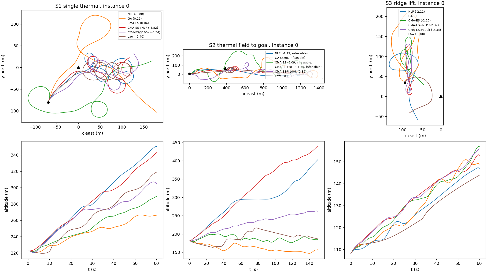
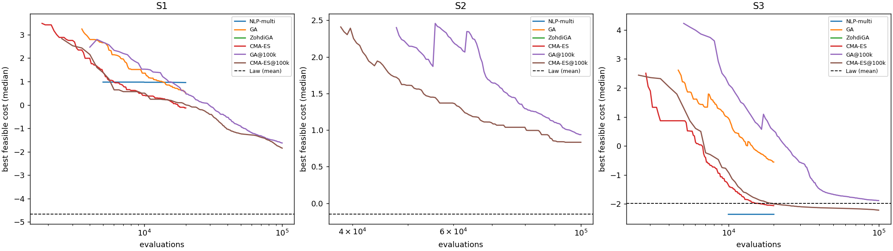
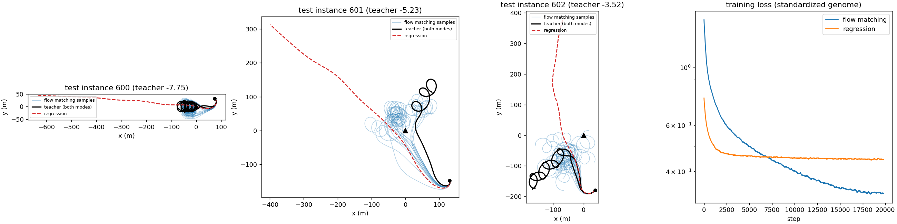
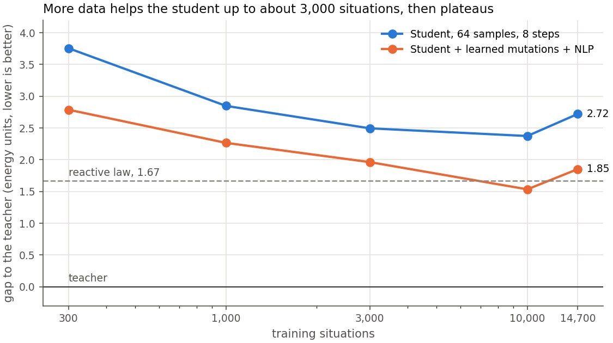
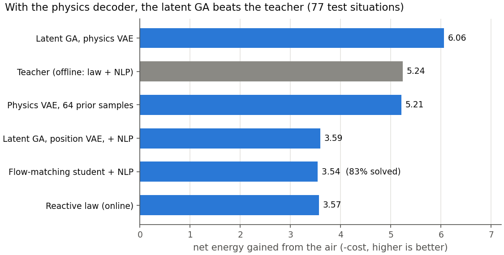
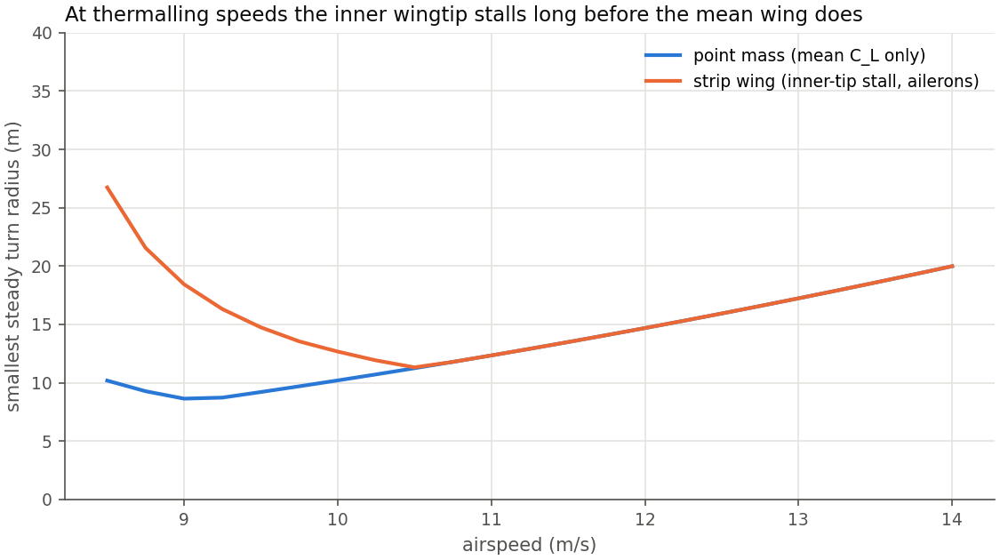

# GeneticWing

Evolutionary, flatness-based planning of energy-harvesting trajectories for
fixed-wing UAVs.

GeneticWing extends the ARPL flat planning pipeline for fixed-wing aircraft
(Morando et al., [ICRA 2025](https://arxiv.org/abs/2502.00581) and
[arXiv 2605.15619](https://arxiv.org/abs/2605.15619)) from efficient gliding
to soaring. An evolutionary search runs over Bernstein-polynomial position
trajectories. Differential flatness turns each candidate into airspeed, C_L,
bank and required thrust with no integration, so a whole population is scored
in one vectorized pass. The best candidate then seeds a local NLP and an
energy-aware NMPC.

## Phase 1: simulation foundation

| Module | Content |
| --- | --- |
| `geneticwing.bernstein` | Bernstein segments and chains, derivatives, batch evaluation |
| `geneticwing.aircraft` | Point-mass airframe, parabolic polar, exact steady glide; Stratosurfer (ARPL platform, placeholder mass and area) and SB-XC sailplane (estimated polar) |
| `geneticwing.flatness` | Flat map: trajectory + wind -> airspeed, C_L, bank, load factor, T_req |
| `geneticwing.energy` | Specific energy, netto variometer |
| `geneticwing.wind` | Level-N1 winds: uniform, thermal (Allen scaling), ridge lift, Dryden turbulence |
| `geneticwing.planning.glide` | Local NLP glide planner (baseline, SciPy SLSQP) |
| `geneticwing.simulation` | Closed-loop point-mass flight: path tracker + attitude lag |
| `scenarios/s0_glide.py` | Scenario S0: reproduction of the ARPL straight glide |

Unpowered, position alone is not a flat output: a glider has two inputs
(C_L, bank) for three outputs. The planner therefore treats `T_req = 0` as a
constraint, which generalizes the sink-rate constraint of arXiv 2605.15619 to
non-uniform wind.

## Scenario S0: reproduction of the ARPL glide

The setup is a 400 m leg from 120 m, with a 12.5 m/s airspeed reference and a
5.2 m/s tailwind. The closed-loop column is the mean of 50 Dryden realizations.

| Metric | ARPL flight | Plan, uniform wind | Closed loop, Dryden |
| --- | --- | --- | --- |
| Mean airspeed (m/s) | 12.50 | 12.50 | 12.61 |
| Mean sink rate (m/s) | 1.48 | 1.58 | 1.61 |
| Glide ratio | 9.83 | 11.15 | 11.27 |
| Airspeed RMSE (m/s) | 1.09 | 0.00 | 0.87 |
| Sink-rate RMSE (m/s) | 0.39 | 0.00 | 0.43 |
| Netto RMSE (m/s) | 0.69 | 0.00 | 0.71 |

The planner converges from 20 out of 20 perturbed initial guesses.

Known gaps, to close with the lab's data:

- Stratosurfer **mass (1.3 kg) and wing area (0.30 m²) are placeholders**. The
  polar is fitted to the best-glide point the paper reports (12 m/s, 1.51 m/s
  sink). As a result, the predicted sink at 12.5 m/s (1.58 m/s) sits above the
  measured 1.48 m/s.
- The paper gives the wind direction but not the leg direction. A pure
  tailwind is assumed.
- The netto filter window (1 s Savitzky-Golay) and Dryden W20 (= mean wind)
  are assumptions.
- The simulation is point-mass with a first-order attitude lag, not 6-DOF.
- The glide ratio is higher than measured: the model has no tracking losses
  beyond turbulence and no airframe imperfections.

## Phase 2: offline teacher (hypothesis H1)

| Module | Content |
| --- | --- |
| `geneticwing.spline` | Clamped B-splines (chains of Bernstein pieces) with initial-state control points |
| `geneticwing.soaring` | Soaring problem: turtle-style genome (turn rate, ground speed, path angle), energy fitness, hinge constraints, Deb ranking |
| `geneticwing.benchmarks` | S1 single thermal, S2 thermal field to a goal, S3 ridge lift, on the SB-XC with a 15 N motor |
| `geneticwing.evolution` | Real-coded GA, the GA of T. Zohdi's course, CMA-ES; equal-budget interface |
| `geneticwing.planning.local` | SLSQP on the same genome, single and multi-start, batched finite differences |
| `geneticwing.policies` | Reactive orbit law (10 parameters) tuned offline by the Zohdi GA |
| `geneticwing.seeding` | Fit a genome to any flight (the law's), to seed the planners |
| `scenarios/ga_tuning.py` | GA hyperparameter sweep on training instances (population 50 wins) |
| `scenarios/phase2_teacher.py` | The study: 3 scenarios x 3 test instances x 11 methods |

Cost is the net onboard energy over the horizon (motor energy minus the
specific energy stored), normalized by level cruise on the motor: `1` means
cruising on the motor, `< 0` means net energy gained from the air. Budget:
20k evaluations, 100k for the `@100k` rows. Mean over the 3 instances,
counting feasible solutions only.

| Method | S1 thermal | S2 field to goal | S3 ridge |
| --- | --- | --- | --- |
| NLP (straight start) | -2.77 | infeasible | -2.11 (1/3) |
| NLP multi-start | 0.96 (2/3) | infeasible | -2.35 (1/3) |
| GA (tuned, population 50) | 0.15 | infeasible | -0.73 |
| Zohdi GA | infeasible | infeasible | infeasible |
| CMA-ES | -0.32 | infeasible | -1.92 |
| CMA-ES + NLP | -3.80 | infeasible | **-2.16** |
| GA @100k | -0.99 | 0.47 | -1.83 |
| CMA-ES @100k | -2.14 | 0.78 | -2.10 |
| Reactive law (Zohdi-tuned) | -4.58 | **-0.02** | -1.96 |
| **Law + NLP** (seeded) | **-6.04** | infeasible | -0.03 |
| Law + CMA-ES + NLP (seeded) | -3.86 | infeasible | -2.03 |

The law rows are simulated with RK4 (see the integration note below); the
other rows come from the exact flat evaluation.




What this says about H1:

- **H1 is not supported as stated.** Even tuned, the real-coded GA is the
  weakest of the working planners at equal budget, and the course's GA (80 %
  random immigrants each generation) finds nothing feasible in 87 to 159
  dimensions.
- **Structure beats search.** The reactive law, tuned offline Zohdi-style,
  encodes the orbit the planners must otherwise discover. Fitting a genome to
  its flight and refining it with the NLP gives the best results on S1
  (-6.04, every instance), 30 % more energy than the law alone.
- **S2 stays out of reach of the planners at 20k**: the law is the only method
  that reaches the goal without spending energy, and only just (-0.02). The
  fixed 150 s horizon with a terminal goal over 159 genes is the likely
  culprit; receding horizon is the fix.
- On S3 the law's flight is fitted less accurately (20 m), and the NLP from it
  ends in a poor optimum; CMA-ES + NLP remains the best there.
- **The teacher is a portfolio** (law + NLP, the law, CMA-ES + NLP), as planned
  in the risk table of the design document. The student does not depend on
  which optimizer produced the data.

Caveats: 3 instances per scenario; point-mass model; the law knows where the
lift is, as the planners do.

## Phase 3: generative student (hypotheses H2, H3, H4)

| Module | Content |
| --- | --- |
| `geneticwing.benchmarks.s1_family` | Randomized single-thermal family (thermal strength, wind, start); heading-frame context and exact left/right mirror |
| `geneticwing.benchmarks.with_margins` | Tightened constraints for the teacher (constraint tightening) |
| `geneticwing.student` | Conditional flow matching (rectified flow), deterministic regression baseline, learned mutation, smoothing |
| `scenarios/phase3_dataset.py` | Teacher dataset: law flight -> fitted genome -> NLP, both orbit modes, 600 train + 80 test instances |
| `scenarios/phase3_student.py` | Training and evaluation against the teacher on held-out instances |

Teacher: 1263 solutions; 593 instances with both orbit modes, 77 with one.
Mean cost -5.43 under the nominal constraints, against -3.97 for the law alone.
Students: MLP 4 x 512, 20k steps on CPU, trained on the data and its mirror.
Evaluation on 78 held-out instances (teacher mean cost -5.19):

| Method | Instances solved | Samples feasible | Mean cost | Gap to teacher | Median time |
| --- | --- | --- | --- | --- | --- |
| Regression (deterministic) | 0 % | 0 % | - | - | 1 ms |
| Flow matching, 64 samples, 1 step | 90 % | 17 % | 0.87 | 6.11 | 28 ms |
| Flow matching, 64 samples, 8 steps | 67 % | 15 % | -2.06 | 3.11 | 49 ms |
| Flow matching + learned mutations | 74 % | 16 % | -1.95 | 3.31 | 137 ms |
| Flow matching + mutations + NLP (2000 evals) | 76 % | 75 % | -2.51 | 2.72 | 1.0 s |
| Reactive law (RK4) | 100 % | 100 % | -3.53 | 1.66 | feedback law |
| NLP from straight flight (2000 evals) | 8 % | 8 % | 1.49 | 6.95 | 0.9 s |

The reactive-law row was rerun with RK4; `docs/figures/phase3_summary.txt` still holds the earlier Euler value (-3.69, gap 1.50).



What this says:

- **H3 holds.** The regression network averages the clockwise and
  counter-clockwise orbits into a straight line out of the thermal (red dashes)
  and never produces a feasible trajectory. Flow matching samples circle in
  the thermal, in both directions.
- **H2 holds only in part.** The student plans in 30 to 50 ms on a laptop CPU
  and finds a feasible soaring trajectory for 67 to 90 % of new instances, but
  keeps only about 40 % of the teacher's energy gain (8-step sampler; the 1-step
  sampler keeps none), and does not yet beat the
  reactive law it was partly distilled from.
- **H4 holds in part.** The NLP warm-started by the student solves 76 % of the
  instances, against 8 % for the same NLP from straight flight, and narrows
  the gap; learned mutations bring nothing measurable here.
- **Feasibility is the bottleneck, as anticipated.** A first teacher solved to
  the nominal constraints sat exactly on them: keeping 99.4 % of the genome's
  variance (48 principal components) already broke 80 % of its solutions, and
  that student solved 25 to 40 % of instances with 3 % feasible samples.
  Solving the teacher with margins (cost: 0.24 of the 5.4 energy units) made
  its solutions 8 to 16 times more tolerant to gene noise and gave the numbers
  above; smoothing the samples took feasibility from 2 to 7 % in a diagnostic.

Caveats: about 1.3k teacher solutions for 87 genes is little data; CPU
training; point-mass model; the law's time is a simulation cost, as a feedback
law it runs in microseconds.

## Phase 3 at scale (Savio) and the GA in a learned space

On Savio (see below), the teacher solved 15,080 situations (27,649 solutions).
All numbers here are on the same 77 held-out situations; the teacher averages
-5.24 there.

| Module | Content |
| --- | --- |
| `geneticwing.latent` | Conditional VAE over genomes, latent GA (`latent_search`) |
| `geneticwing.torchsim` | Batched point-mass simulator, PyTorch (differentiable) and NumPy, RK4, commands bounded by construction |
| `geneticwing.physvae` | Command VAE: teacher commands read off by the flat map, decoded and flown; latent GA over it |
| `geneticwing.benchmarks.canonical_scenario` | A situation in the aircraft's frame, built from its 6-number context |
| `scenarios/phase3_latent.py`, `phase3_physics.py` | The two latent-GA studies (round trip, prior samples, latent GA, improvement loop) |
| `scenarios/phase3_realism.py` | The same turn limit (radius, or `--strip`) for the teacher and the latent GA |
| `geneticwing.strip` | Strip-theory wing in a turn: inner-wing stall, aileron authority and drag |
| `scenarios/phase3_unsolved.py` | Why the strip teacher leaves situations unsolved: violated constraints, other seeds |
| `scenarios/report_figures.py` | The figures below, from the folder copied back from Savio |

### The student's scaling curve (H2)



More data helps up to about 3,000 situations, then the gap plateaus (one run
per size; 10k versus all is within noise). Beyond that point the limit is the
model, not the data. H3 holds at every size: regression solves at most 12 %.

### Genetic search in a learned latent space (H1 reformulated)

The phase 2 GA failed on 87 coupled genes. Here a conditional VAE compresses
the teacher's trajectories into a few latent dimensions, and the same GA
(population 50, 3,000 evaluations) searches that space; each individual is
decoded and checked (latent variable evolution: Volz et al. 2018; data-driven
encodings: Gaier, Asteroth and Mouret 2020).

| Method (77 situations) | Solved | Mean cost | Gap |
| --- | --- | --- | --- |
| GA on the 87 genes + NLP | 55 % | +1.92 | 7.09 |
| Latent GA + NLP, 8 / 16 / 32 latent dimensions | 100 % | -3.32 / **-3.59** / -3.42 | 1.92 / 1.64 / 1.81 |
| Same, d = 16, after one improvement round | 100 % | -3.73 | 1.51 |

The latent space rescues the GA (55 % to 100 % solved). The improvement loop
(the latent GA revisits 2,000 teacher solutions per round, about 15 % of them
improve slightly, the VAE is retrained) brings little after one round: H6 is
not supported here. The bottleneck is the decoder: the teacher's own
trajectory survives the encode-decode round trip in only about 20 % of cases,
because small position errors become large C_L and thrust errors.

### Physics decoder

The decoder now outputs **commands** (C_L, bank, thrust at 61 knots), squashed
into their limits, and a point-mass simulator (`geneticwing.torchsim`, with a
load limiter) turns them into the trajectory: C_L, bank, thrust and load
factor cannot be violated. The VAE learns the teacher's commands, read off its
trajectories by the flat map (`geneticwing.physvae`). Commands are bounded by
the teacher's own margins, so every method faces the same feasible set.

| Method (77 situations) | Solved | Mean cost | Gap | Time per plan |
| --- | --- | --- | --- | --- |
| Teacher's commands flown open loop | 100 % | -4.70 | 0.54 | 0.14 s |
| Teacher round trip (encode, decode, fly) | 100 % | -4.64 | 0.59 | 0.14 s |
| **64 prior samples of the physics VAE**, best kept (d = 8) | 100 % | **-5.21** | **0.03** | **0.2 s** |
| **Latent GA, physics VAE** (d = 16) | 100 % | **-6.06** | **-0.82** | 12.6 s |
| Latent GA, physics VAE, + NLP (d = 16) | 100 % | -6.02 | -0.78 | 14.2 s |



- The round trip goes from 20 % to 100 % feasible, and every method using
  this decoder jumps from about -3.6 to between -5 and -6.
- **The latent GA beats the teacher** by 0.82 energy units on average, with
  the same margins. It does so by circling tighter (median radius 15 to 25 m
  instead of 21 to 29 m), which the genome's turn-rate bound (30 deg/s) did not
  allow the teacher.
- **64 random samples of the physics VAE match the teacher in 0.2 s** with no
  search: a candidate for real-time planning.
- **The gain depends on how tight a real sailplane can turn** (realism test
  below).

### Realism test: one minimum turn radius for every method

`scenarios/phase3_realism.py` re-solves the teacher and runs the physics
latent GA under the same limit on the coordinated-turn radius
`V^2 / (g tan|bank|)` (77 situations, teacher margins for both).

| Minimum radius | Teacher | Physics latent GA | Gap (GA - teacher) | 64 prior samples (solved) |
| --- | --- | --- | --- | --- |
| none | -5.22 | -6.06 | **-0.85** | -5.10 (100 %) |
| 12 m | -5.22 | -5.86 | **-0.64** | -5.03 (100 %) |
| 15 m (about 3 spans) | -5.23 | -5.56 | **-0.35** | -4.20 (97 %) |
| 18 m | -5.09 | -4.42 | +0.67 | -1.86 (65 %) |

The teacher hardly changes: its genome already avoided tight turns. Most of
the latent GA's gain comes from turning tighter; it survives at 12 to 15 m
(plausible for this airframe) and reverses at 18 m, where the command space
learned from the teacher covers wide circles poorly. The real turn limit is
the open question: a span-resolved (strip) wing model is the next step.

### Strip wing: the real turn limit

`geneticwing.strip` cuts the 4.6 m span into 40 strips. In a turn of radius R
each strip flies at `V (1 + y cos(bank) / R)`: the slower inner wing lifts
less, the ailerons must add lift there to hold the bank, so the inner tip
reaches stall before the mean wing does, the ailerons can run out of
authority, and their deflection costs drag. Turn on with `strip_wing` in a
scenario (constraints `wing_stall`, `aileron`; aileron drag added to the
thrust the trajectory needs).



At thermalling speed (9 m/s) the smallest steady radius is 18 m with the strip
wing against 9 m for the point mass; the absolute minimum is about 11 m, at
10.5 m/s.

Re-running the comparison with the strip wing applied to every method (77
situations; `phase3_realism.py --strip`):

| Method | Solved | Mean cost | Gap to teacher |
| --- | --- | --- | --- |
| Teacher, re-solved with the strip wing | 100 % | -4.70 | - |
| Physics latent GA | 100 % | -4.28 | +0.42 |
| 64 prior samples of the physics VAE | 66 % | -1.23 | 3.70 |

Realistic wing physics costs everyone (the teacher loses 0.5 units: it too
was turning tighter and slower than a real wing allows), and the latent GA's
advantage disappears: it searches a space learned from point-mass
trajectories, whose best circles are now forbidden, while the NLP adapts to
the new constraint directly. The fix is in the data: regenerate the teacher's
dataset with the strip wing and retrain the command VAE on it.

### Strip wing, retrained

The teacher re-solved 3,080 situations (ids 1000-3999 for training, 600-679
for test) with the strip wing: 2,833 solutions, 2,757 for training. Run on
three desktop machines in about 1 h 15 (`--strip` shards, then
`phase3_merge.py`), followed by `phase3_physics.py --strip --margins` with
latent sizes 8, 16 and 32.

The strip wing removes many situations: about 40 % of them have no
trajectory feasible under the teacher's margins in either direction (2 % for
the point mass). The test set keeps the 49 situations of 80 the teacher solves.

| Method (49 test situations) | d = 8 | d = 16 | d = 32 |
| --- | --- | --- | --- |
| Teacher | -4.97 | -4.97 | -4.97 |
| 64 prior samples of the command VAE (solved) | -4.73 (100 %) | -4.73 (100 %) | -4.72 (100 %) |
| Physics latent GA | -5.70 | -5.99 | -5.89 |
| Physics latent GA + NLP | -5.71 | **-6.02** | -5.89 |

Trained on strip-wing trajectories, the prior goes from 66 % solved at -1.23
to 100 % at -4.73, and the latent GA beats the teacher again, by 1.05 units at
d = 16 (0.82 for the point mass on Savio). The test set is the situations the
teacher solves, so the comparison says nothing about the other 40 %.

Why the teacher fails (`phase3_unsolved.py`, 128 unsolved situations, 31 of
them test ones): the family has a motor, so feasible trajectories always
exist, and every failure is the optimizer's. In all 128 the NLP ends with the
inner wing stalled (`wing_stall`), sometimes with `brake`, `cl` or `thrust_max`
too. Retrying from other seeds, under the same margins:

| Seed for the NLP | Feasible | Mean cost of those |
| --- | --- | --- |
| The law with a faster orbit (orbit-speed gene 0.8) | 52 % | -4.63 |
| The straight glide | 40 % | +0.91 |
| The law with a wider orbit (80 or 120 m) | 9-19 % | about +1 |
| The same law, solved without the margins | 23-33 % | about -5.3 |
| Any of them | 84 % | -2.76 (59 % with cost < 0) |

The fix is a faster orbit, not a wider one: at a lower lift coefficient the
slower inner wing keeps a stall margin, and those solutions harvest about as
much as the teacher's usual ones. Wide circles and the straight glide are
feasible but harvest nothing. Re-solving the teacher's own seed on another
machine also rescues 3-19 % of the situations: SLSQP from the same start
lands differently with numpy 2.2 on Windows and 2.5 on Linux.

The strip teacher now seeds each orbit direction twice, with the tuned law
and with the faster orbit, and keeps the better solution (`law_seeds` in
`phase3_dataset.py`; the dataset's `rec_seed` says which won). On test
situations 600-631: unsolved situations 12 -> 4, solutions 34 -> 49 (40 of them
from the faster orbit), a better cost on 17 of the 20 situations both teachers
solve (mean -5.43 against -5.34), 8 rescued at -4.59, none lost; about 2.2
times the teacher's time.

The seed law is tuned on the point-mass wing, also for `--strip` datasets.
Tuned under the strip wing, the GA on the law's parameters converged to orbits
the NLP could not repair: on 16 test situations, 3 feasible at +0.45 against
13 feasible at -5.41 with the point-mass law. The first strip run used that
law and was discarded.

### Integration note (RK4)

The first simulators used explicit Euler steps. Lift turns the velocity, and
every Euler step adds `(a dt)^2` to its square: free energy in turns, which a
search on the physics decoder harvested (costs three times better than the
teacher). All simulators now use RK4 (`geneticwing.simulation.rk4_step`); a
steady glide turn loses exactly the polar's sink, even with 0.4 s steps.
Earlier results affected: the reactive law's online cost was about 4 % too
optimistic (on the 77 Savio situations: -3.73 with Euler, -3.57 with RK4).
Costs of the teacher, planners, students and position VAE come from the
exact flat evaluation and are unchanged.

Next steps: the strip dataset regenerated with the two-seed teacher, and the
command VAE retrained on it; the sensitivity of the comparison to the
SB-XC's estimated polar (`submit_all.sh sensitivity`); then phase 4: closed-loop flight with turbulence and
wind-estimation errors (H5).

## Usage

```bash
pip install -e ".[dev]"
python -m pytest
python scenarios/s0_glide.py --out results
python scenarios/phase2_teacher.py --out results/phase2 --workers 8
python scenarios/phase3_dataset.py --train 600 --test 80
python scenarios/phase3_student.py --steps 20000
python scenarios/phase3_latent.py --data results/phase3/dataset.npz
python scenarios/phase3_physics.py --data results/phase3/dataset.npz --margins
python scenarios/report_figures.py --src results/savio_phase3
```

## Running phase 3 at scale on Savio (Berkeley)

The teacher's dataset is the expensive part (about 20 core-seconds per
instance) and splits into independent shards; the students train on GPU.
`slurm/submit_all.sh` chains four jobs: tune the law once, solve the shards
(one node each, plus one for the test set), merge, then train and evaluate one
student per training-set size (the scaling study). With the defaults, 15k
training instances cost about 80 core-hours of CPU and five short GPU jobs.

On a login node, once:

```bash
git clone https://github.com/clementdumeril/GeneticWing.git
cd GeneticWing
bash slurm/check_savio.sh      # prints your accounts, partitions, QoS and GPU types
nano slurm/config.sh           # set ACCOUNT, the CPU/GPU partitions and QoS, the Python module
bash slurm/setup_env.sh        # venv in /global/scratch/users/$USER/geneticwing
```

Then:

```bash
bash slurm/submit_all.sh       # law -> shards -> merge -> students
squeue -u $USER
bash slurm/submit_all.sh train # later: retrain only, on the merged dataset
bash slurm/submit_all.sh latent    # latent GA (position VAE)
bash slurm/submit_all.sh physics   # latent GA with the physics decoder
bash slurm/submit_all.sh strip     # strip wing: teacher re-solved, then the physics decoder (phase3_strip/)
bash slurm/submit_all.sh sensitivity  # SB-XC polar +-20 %, on the strip comparison (dataset and VAE copied to phase3_strip/)
```

Results land in `/global/scratch/users/$USER/geneticwing/phase3/students/n_<size>/`
and logs in `.../phase3/logs/`. Sizes, shard counts, budgets and walltimes are
all in `slurm/config.sh`.

Conventions: ENU frame (z up), SI units, wind is the air-mass velocity.
Arrays are `(..., N, 3)` so populations evaluate in one call.

## License

MIT, see [LICENSE](LICENSE).
