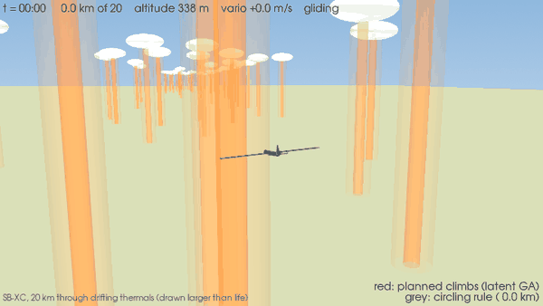
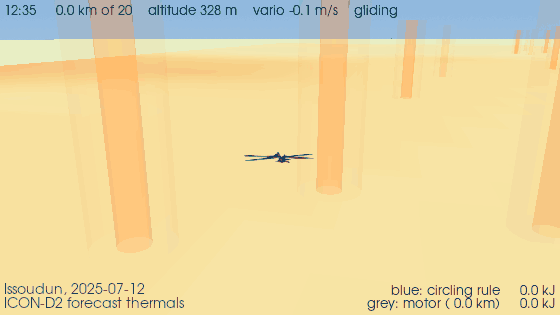
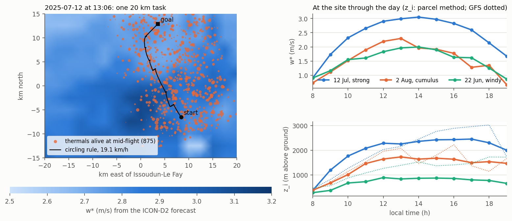

# GeneticWing: a generative planner for a sailplane's climbs in thermals



*Simulated flight, first 8 km of 20. Red: climbs planned by the genetic search in the learned space. Grey: the standard
circling rule. Same tactician, same thermals.* Fly it in the browser (3D):
[20 km flight](https://clementdumeril.github.io/GeneticWing/viewer/xc_20km.html) ·
[60 s climb](https://clementdumeril.github.io/GeneticWing/viewer/climb_60s.html) ·
[real forecast over Issoudun](https://clementdumeril.github.io/GeneticWing/viewer/weather_issoudun.html)

GeneticWing plans every thermal climb of a simulated sailplane flying cross-country.

- It climbs 1.7 times faster than the standard circling rule: 2.23 against 1.29 m/s on 64 simulated 20 km flights,
  with the same tactician choosing the thermals.
- It keeps the gain on 64 tasks no training step has seen: 2.21 against 1.30 m/s.
- It plans a climb in 0.24 s, 56 times faster than the genetic search it was distilled from (13.4 s per climb).

Chain: teacher, command VAE, genetic search in the VAE's latent space, flow-matching generator, one DAgger-like round. It
extends ARPL's flatness-based glide planning (Morando et al., [ICRA 2025](https://arxiv.org/abs/2502.00581)) from
gliding to soaring. Simulation only; the thermals are known.

[Project site](https://clementdumeril.github.io/GeneticWing/) · [Detailed results](docs/RESULTS.md) ·
[Implementation](docs/IMPLEMENTATION.md) ·
[Slides, in French](docs/slides/geneticwing_results.pdf) · Related:
[Fixed-Wing](https://github.com/clementdumeril/Fixed-Wing), [WingJEPA](https://github.com/clementdumeril/WingJEPA)

## How it works

- A slow offline teacher (a circling law tuned by a genetic algorithm, then refined with SLSQP) solves 20,923
  single-thermal climbs.
- A VAE learns the teacher's commands (lift coefficient, bank, thrust) and writes each climb as 16 numbers. Its
  decoder flies them through a point-mass simulator, so every sample respects the aircraft's limits.
- A genetic algorithm searching those 16 numbers beats the teacher, but takes about 13 s per climb.
- A flow-matching generator learns the search's answers. In flight it proposes 64 climbs, flies each in the
  simulator and keeps the best, in 0.24 s. One DAgger-like round retrains it on 1,095 states the genetic search met in flight.
- A MacCready tactician picks the thermals; the planner flies every climb. The autopilot keeps every wing section
  below 90 % of its stall.


## In the thermals of a real day



*Issoudun, 12 July 2025. Blue: the circling rule, 20 km in 53 minutes without the battery. Grey: the motor all the
way, 49 minutes and 114 kJ. Ground coloured by the forecast thermal strength.*
[Open it in 3D](https://clementdumeril.github.io/GeneticWing/viewer/weather_issoudun.html).

- The thermals come from the archived DWD ICON-D2 forecast over Issoudun-Le Fay for three days of 2025: the
  forecast heat flux and convective layer give their strength point by point and hour by hour (Allen's model).
  They grow, drift with the forecast wind and fade.
- On the two good days the circling rule flies 48 of 48 tasks at MacCready 1 almost without the motor (1.3 and
  0.5 kJ on average, against 121 and 89 kJ on the motor), 1 to 3 km/h slower.
- On the windy day (about 7 m/s of wind for a 9 m/s best-glide speed) it arrives on half the tasks: a day for
  the motor. The genetic search and the generator have not flown these days yet.



## Run it

Python 3.11, Windows 10 or Linux.

```bash
pip install -e ".[dev]"                                # numpy, scipy, matplotlib, torch, pytest
python -m pytest -q                                    # 69 tests, about 2 min
python scenarios/s0_glide.py --out results             # replays the ARPL straight glide, about 4 min
python scenarios/phase2_teacher.py --out results/phase2 --workers 8
```

Phases 3 to 6 run on a Slurm cluster: set `slurm/config.sh`, then `bash slurm/submit_all.sh`. All commands:
[`docs/RESULTS.md`](docs/RESULTS.md#usage-all-phases). Code layout: [`docs/IMPLEMENTATION.md`](docs/IMPLEMENTATION.md#code-layout).

## Limitations

- Simulation only: point-mass dynamics with a strip-theory wing in turns, no flight test.
- The thermals are known exactly; the planner never updates its belief in flight.
- One run per method, no spread over seeds.
- The airframe is estimated: with 20 % more mass or 20 % less maximum lift, the search's lead over the teacher
  almost vanishes.

## Credits and license

Flatness-based planning, glide data and energy definitions: Morando et al., ARPL. Baseline GA and reactive law:
T. Zohdi's course. Thermal model: M. J. Allen. Full list in [docs/IMPLEMENTATION.md](docs/IMPLEMENTATION.md#credits).

Clément Dumeril, [clement.dumeril.net](https://clement.dumeril.net). MIT license ([LICENSE](LICENSE)); citation
metadata in [CITATION.cff](CITATION.cff).
