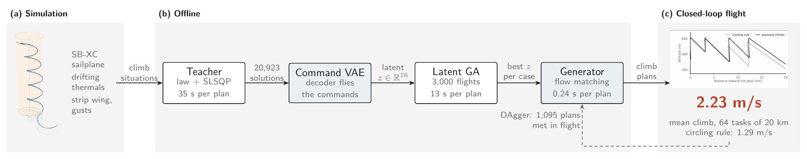
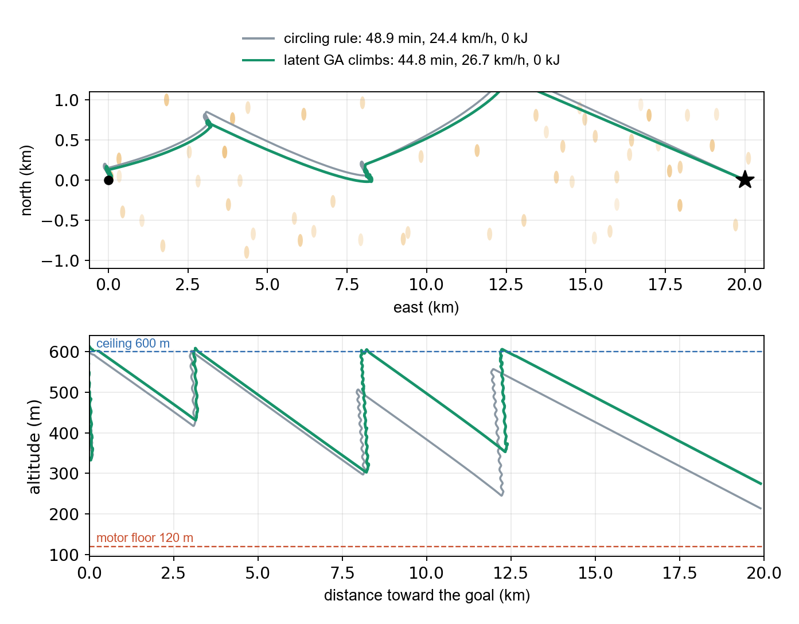

# GeneticWing: soaring trajectory planning for a fixed-wing UAV with genetic search in a learned latent space

[Phase-by-phase results](docs/RESULTS.md) · [Implementation](docs/IMPLEMENTATION.md) ·
[Results slides, in French](docs/slides/geneticwing_results.pdf) · [3D flight viewers](docs/viewer/) (HTML, open
locally) · Related: [Fixed-Wing](https://github.com/clementdumeril/Fixed-Wing),
[WingJEPA](https://github.com/clementdumeril/WingJEPA)



A simulated SB-XC sailplane plans its thermal climbs with a flow matching generator distilled from a genetic search
over a learned command space. On 64 cross-country tasks of 20 km it climbs at 2.23 m/s against 1.29 m/s for a
circling rule with the same tactician (MacCready 0.5), at 0.24 s per plan; one run per method, thermals known.

## Method

Started October 2026, simulation only. It extends the flatness-based glide planning of Morando et al. at ARPL
([ICRA 2025](https://arxiv.org/abs/2502.00581), [arXiv 2605.15619](https://arxiv.org/abs/2605.15619)) from
efficient gliding to soaring. A slow offline teacher (reactive law + SLSQP) solves thousands of single-thermal
situations. A VAE learns the teacher's commands (C_L, bank, thrust), and its decoder flies them through a
point-mass simulator, so every sample respects the aircraft's limits. A genetic algorithm searching that latent
space beats the teacher; a flow matching model distills the GA into a 0.24 s planner, and one DAgger round retrains
it on the states met in flight. A MacCready tactician picks the thermals; the planner flies every climb.

## Results



*One 20 km task, same tactician: the circling rule (grey) and climbs planned by the latent GA (green), motor off in
the climbs. Top: path and the drifting thermals; bottom: altitude against the distance flown toward the goal.*

| Climbs (64 tasks of 20 km, MacCready 0.5 / 1) | Mean climb (m/s) | Speed (km/h) | Battery (kJ) |
| --- | --- | --- | --- |
| Motor all the way | | 29.2 | 61.9 |
| Circling rule | 1.29 / 1.22 | 24.9 / 28.3 | 2.9 / 19.3 |
| Latent GA, about 13 s per plan | 2.08 / 2.07 | 28.2 / 29.5 | 2.9 / 4.7 |
| Generator distilled on single-thermal situations only | 1.50 / 1.17 | 25.1 / 28.8 | 4.2 / 20.2 |
| **Generator after one DAgger round, 0.24 s per plan** | **2.23 / 2.20** | **28.5 / 30.2** | **2.9 / 4.7** |

One cluster run per row; source: [`docs/RESULTS.md`](docs/RESULTS.md), phases 5 and 6 (raw outputs not committed).
Every pilot flies the same tasks with the same tactician and autopilot. At MacCready 1 the DAgger generator is as
fast as flying on the motor (30.2 against 29.2 km/h) with 13 times less battery, with no wing-section stall. The
single-thermal comparison with the teacher and how the chain was found: [`docs/IMPLEMENTATION.md`](docs/IMPLEMENTATION.md).

## Install and quick start

Tested with Python 3.11 on Windows 10 and on Linux. Dependencies are not pinned.

```bash
pip install -e ".[dev]"            # numpy, scipy, matplotlib; torch and pytest for the students and tests
python -m pytest -q                # 69 passed, about 2 min
python scenarios/s0_glide.py --out results           # about 4 min, replays the ARPL straight glide
python scenarios/phase2_teacher.py --out results/phase2 --workers 8
```

The phase 3 to 6 studies run on a Slurm cluster: set the account and partitions in `slurm/config.sh`, then
`bash slurm/submit_all.sh` (all commands: [`docs/RESULTS.md`](docs/RESULTS.md#usage-all-phases)).

## Code structure

| Path | Content |
| --- | --- |
| `src/geneticwing/` | flat planning core, aircraft and strip wing, wind models, simulators, GA and NLP planners, VAEs, students, cross-country pilot |
| `scenarios/` | one script per phase (`s0_glide.py` to `phase6_distill.py`), figures, 3D viewers |
| `slurm/` | cluster jobs, chained by `submit_all.sh` |
| `tests/` | 69 tests |
| `docs/` | [results](docs/RESULTS.md), [implementation](docs/IMPLEMENTATION.md), figures, slides, viewers |

## Limitations

- Simulation only: point-mass dynamics with a strip-theory wing in turns, not 6-DOF, and no flight test.
- Airframes are estimates (SB-XC polar, C_L max, mass); the gain over the teacher shrinks to about 0.1 when the stall
  margin is reduced (mass or C_L max off by 20 %).
- One run per method on the cluster studies: no spread over seeds is reported.
- On the cross-country tasks the thermals are known exactly; the planner's belief is never updated in flight.
- The raw outputs of the cluster runs are not in the repository, so phases 3 to 6 can be checked only by rerunning.

## Credits and citation

Flatness-based planning, glide data and energy definitions: Morando et al., ARPL. Baseline GA and reactive law:
T. Zohdi's course. Thermal model: M. J. Allen. Full list in [docs/IMPLEMENTATION.md](docs/IMPLEMENTATION.md#credits).

Clément Dumeril, [clement.dumeril.net](https://clement.dumeril.net). MIT license ([LICENSE](LICENSE)); citation
metadata in [CITATION.cff](CITATION.cff).
