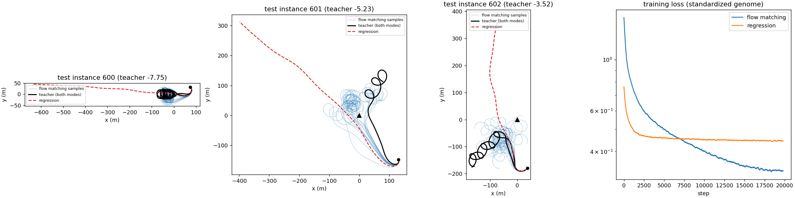

# Implementation details

Detail moved out of the top-level README. Phase-by-phase results and every table: [`RESULTS.md`](RESULTS.md).

## Planning core

Trajectories are Bernstein-polynomial position curves; differential flatness turns each into airspeed, C_L, bank
and required thrust without integration, so a population is scored in one vectorized pass. The polar and energy
definitions follow Morando et al. (ARPL); one baseline GA follows the scheme of T. Zohdi's course. On the raw
trajectory parameters the GA is the weakest working planner (phase 2). It becomes the best planner once it searches
the latent space of a VAE whose decoder outputs bounded commands (C_L, bank, thrust at 61 knots) and flies them
through a simulator; a flow matching model then distills it into a fast generator, retrained once with DAgger on
the states met in flight.

## Components

| Component | Path | What it is |
| --- | --- | --- |
| Flat planning core | `src/geneticwing/bernstein.py`, `spline.py`, `flatness.py`, `energy.py` | Bernstein and B-spline trajectories, flat map to airspeed, C_L, bank, load factor and thrust, specific energy, netto variometer |
| Aircraft and wind | `aircraft.py`, `strip.py`, `wind/` | point-mass polar (Stratosurfer, SB-XC), strip-theory wing with inner-wing stall and aileron drag, thermals (Allen scaling), ridge lift, Dryden turbulence |
| Simulators | `simulation.py`, `torchsim.py`, `closedloop.py` | RK4 closed-loop point-mass flight with path tracker and attitude lag; batched NumPy and PyTorch twins; replanning in turbulence with a wrong belief |
| Teachers and baselines | `evolution.py`, `planning/`, `policies.py`, `soaring.py`, `benchmarks.py` | real-coded GA, Zohdi-style GA, CMA-ES, SLSQP NLP, reactive orbit law tuned offline, scenarios S0 to S3 |
| Learned planners | `student.py`, `latent.py`, `physvae.py` | flow matching and regression students, position VAE, command VAE with simulator decoder, latent GA |
| Cross-country | `crosscountry.py` | 20 km tasks in a field of drifting thermals, MacCready tactician, planned climbs |
| Studies | `scenarios/` | one script per phase (`s0_glide.py` to `phase6_distill.py`), figures, 3D viewers |
| Cluster pipeline | `slurm/` | `submit_all.sh` chains teacher shards, merge, training and studies |
| Tests | `tests/` | 69 tests |

## Single-thermal planners (phase 6)

Cost: net onboard energy over the plan (motor energy minus the energy stored), normalized by level cruise on the
motor; negative means energy gained from the air. Strip-wing model, teacher's constraint margins for every method.

| Method (65 held-out single-thermal situations) | Solved | Mean cost | Gap to teacher | Time per plan |
| --- | --- | --- | --- | --- |
| Teacher (law + NLP) | 100 % | -4.88 | | about 35 s |
| 64 samples of the VAE prior, best kept | 100 % | -4.64 | +0.24 | 0.24 s |
| Latent GA, 3,000 flights | 100 % | -5.66 | -0.78 | 13.4 s |
| Distilled generator, 1 sample | 94 % | -3.52 | +1.30 | 0.14 s |
| Distilled generator, 64 samples, best kept | 100 % | -5.72 | -0.85 | 0.24 s |



*Phase 3, three held-out single-thermal situations: 64 flow matching samples (blue) circle in the thermal in both
directions like the teacher (black); a regression network (red) averages the two orbit directions into a straight
line out of the thermal. Made with `scenarios/phase3_student.py`.*

## How the chain was found

1. Phase 2, three scenarios, 3 instances each: at equal budget the GA on 87 to 159 trajectory genes is the weakest
   working planner (S1 cost 0.15 against -6.04 for law + NLP), and the GA of Zohdi's course finds nothing feasible
   ([`figures/phase2_summary.txt`](figures/phase2_summary.txt)).
2. A VAE over positions lets the GA solve 100 % of situations instead of 55 %, but only 20 % of the teacher's own
   trajectories survive its round trip. Decoding commands through a simulator makes every sample feasible.
3. The explicit Euler simulators gave free energy in turns, which the search exploited (costs three times better
   than the teacher). All simulators now use RK4.
4. A strip-theory wing shows the real turn limit is the inner wing's stall: 18 m minimum radius at 9 m/s against 9 m
   for the point mass ([`figures/turn_limits.png`](figures/turn_limits.png)).
5. Without the inner-wing protection in the autopilot, 19 to 69 % of the GA's flights stalled a wing section; with
   it none do, and the GA keeps its lead (2.08 against 2.09 m/s at MacCready 0.5).
6. The first distilled generator, trained only on level starts at 180 to 320 m, lost most of the GA's lead in
   flight; one DAgger round on 1,095 plans recorded in flight recovered it.

## Check against flight data

Scenario S0 replays the ARPL straight glide of arXiv 2605.15619 (400 m leg, 12.5 m/s, 5.2 m/s tailwind). With
placeholder mass and wing area, the plan sinks at 1.58 m/s against 1.48 measured, and the closed loop in Dryden
turbulence (50 realizations) has a netto RMSE of 0.71 m/s against 0.69 in flight
([`figures/s0_metrics_rk4.json`](figures/s0_metrics_rk4.json)).

## Running the studies

```bash
python scenarios/s0_glide.py --out results           # about 4 min; prints the S0 table:
                                                      # sink_rate_mean 1.48 (flight) 1.58 (plan) 1.61 (sim+Dryden)
python scenarios/phase2_teacher.py --out results/phase2 --workers 8
python scenarios/phase3_dataset.py --train 600 --test 80
python scenarios/phase3_student.py --steps 20000
```

The phase 3 to 6 studies run on a Slurm cluster: set the account and partitions in `slurm/config.sh`, then
`bash slurm/submit_all.sh` (teacher, merge, students), followed by `strip`, `physics`, `distill`, `xc` or `dagger`
as the first argument. With the defaults, 15k training situations cost about 80 core-hours. All commands and options:
[`RESULTS.md`](RESULTS.md#usage-all-phases).

## Figures

| Figure | Command | Data |
| --- | --- | --- |
| `phase2_trajectories.png`, `phase2_convergence.png`, `phase2_summary.txt` | `python scenarios/phase2_teacher.py --out results/phase2` | none, runs the study |
| `phase3_student.png`, `phase3_summary.txt` | `python scenarios/phase3_student.py` | `phase3_dataset.py` output |
| `scaling.png`, `methods.png`, `turn_limits.png` | `python scenarios/report_figures.py --src <phase 3 folder from the cluster>` | cluster outputs, not committed |
| `closed_loop_tracking.png`, `slides/xc_flight.png` | no committed script | |
| `xc_flight_20km.png` | `slides/xc_flight.png` with the French labels replaced by English ones | |
| `overview.svg` / `overview.png` | hand-written SVG, rendered with headless Chrome at 2x; crops in `figures/overview/` | |
| `pipeline.png` (README) | `pdflatex figures/pipeline/pipeline.tex`, then the PDF rendered at 130 dpi | the poster's chain diagram |
| `xc_20km_3d.gif` (README) | `python scenarios/xc_render3d.py results/phase5_view/xc.html docs/figures/xc_20km_3d.gif --fps 10 --climb-step 1 --glide-step 10 --until 1300 --size 560 315 --frame-ms 100` | `phase5_view.py` output |

## Credits

- Flatness-based fixed-wing planning, Stratosurfer glide data, energy and netto definitions: Morando et al., ARPL,
  ICRA 2025 ([arXiv:2502.00581](https://arxiv.org/abs/2502.00581)) and [arXiv:2605.15619](https://arxiv.org/abs/2605.15619).
- GA scheme of the baseline and the offline-tuned reactive law: T. Zohdi's course and drone-swarm work.
- Latent variable evolution: Volz et al. 2018; data-driven encodings: Gaier, Asteroth and Mouret 2020.
- Thermal model: M. J. Allen, AIAA 2006-1510. Path following and course law: R. Beard and T. McLain, *Small Unmanned
  Aircraft*, 2012.
