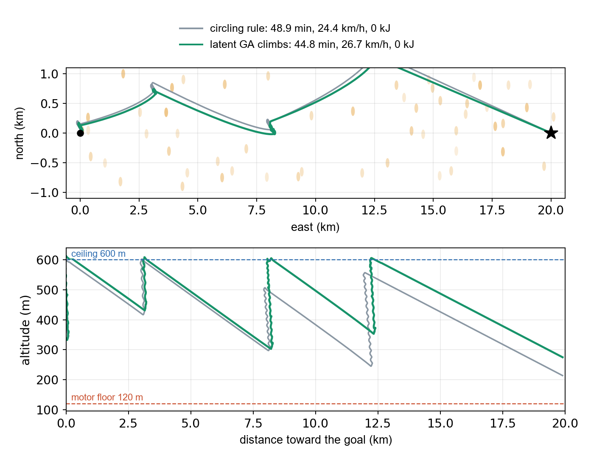
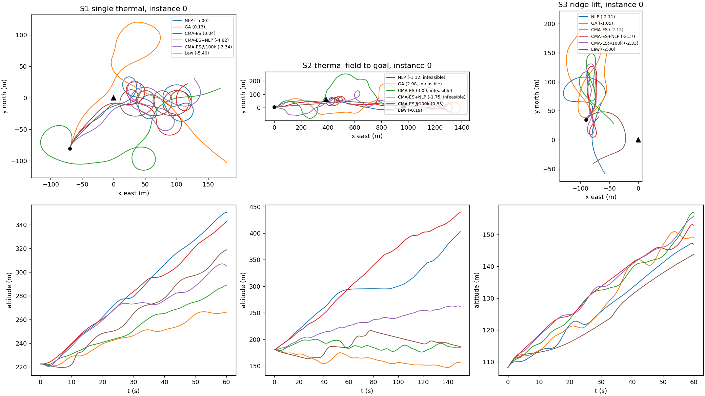
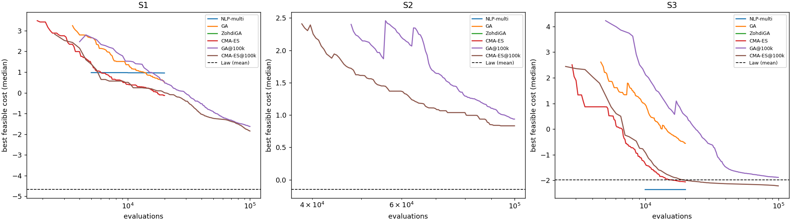
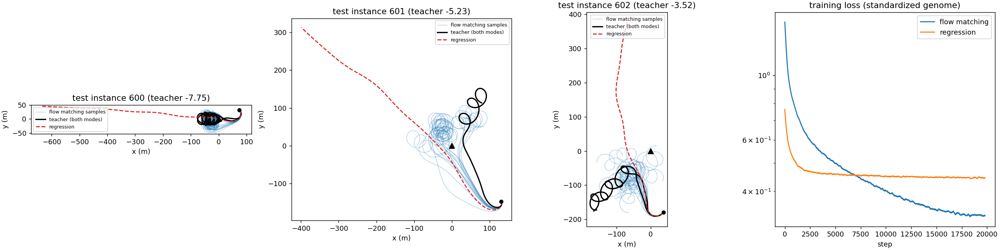
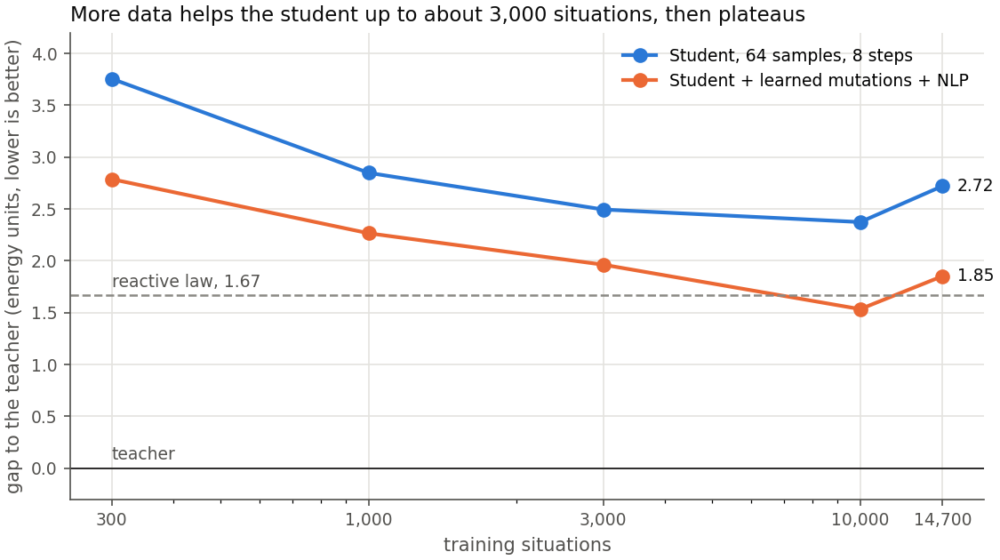
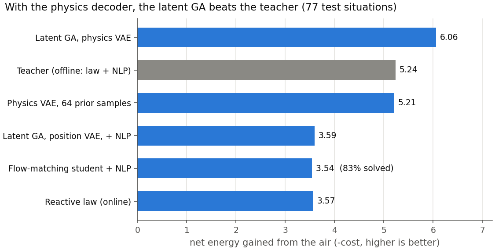
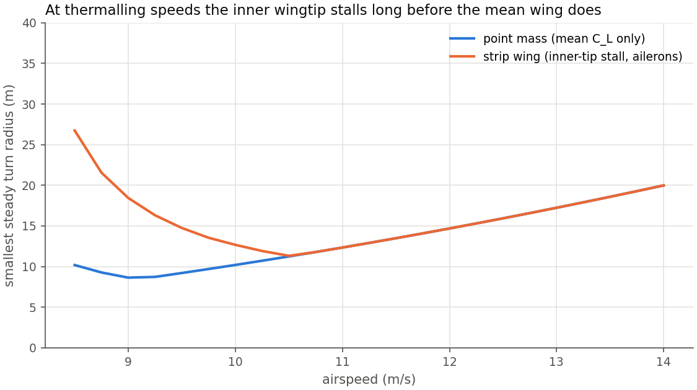
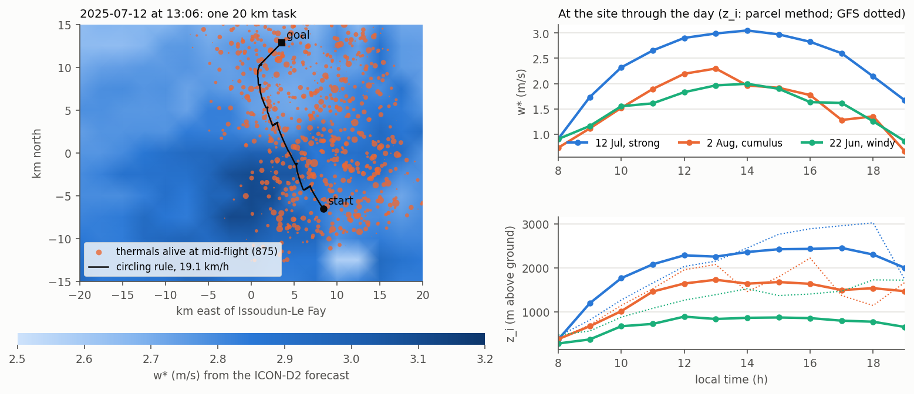

# GeneticWing: phase-by-phase results

The full record of the project, phase by phase, moved here from the top-level README (which keeps the summary).
Numbers come from the runs described in each section; the raw outputs of the cluster runs stay on the cluster
(`/global/scratch/users/$USER/geneticwing/`), and the small summaries that are committed are in
[`figures/`](figures/). Costs: net onboard energy over the horizon (motor energy minus the specific energy stored),
normalized by level cruise on the motor; `1` means cruising on the motor, `< 0` means net energy gained from the air.
H1 to H6 are the hypotheses of the project's design document, which is not in the repository.

## Summary: the 20 km cross-country flights

Moved from the top-level README. The raw outputs of the cluster runs are not in the repository, so phases 3 to 6
can be checked only by rerunning. Background: the project extends the flatness-based glide planning of
Morando et al. ([ICRA 2025](https://arxiv.org/abs/2502.00581), [arXiv 2605.15619](https://arxiv.org/abs/2605.15619))
from efficient gliding to soaring; it started in October 2026 and is simulation only.

The 3D animation in the README shows the first 8 km of a 20 km flight in the simulator, two climbs: 22 minutes in
49 s, ten times faster than life in the climbs and a hundred times in the glides. The red sailplane plans every climb
with the latent GA; its trail turns green where it climbs. The grey one flies the same task with the same tactician
but a fixed circling rule. Thermal columns drift with the wind, capped by their cumulus at the 600 m cloud base. The
red sailplane leaves the second thermal 100 s ahead of the grey one; over the whole task it arrives 4 minutes
earlier (26.7 against 24.4 km/h), and neither uses its battery. Aircraft and thermal cores are drawn larger than
life. It is rendered with `scenarios/xc_render3d.py`; the 3D viewers are built by `scenarios/phase4_view.py` and
`scenarios/phase5_view.py`, then `scenarios/publish_viewers.py`.



*One 20 km task, same tactician: the circling rule (grey) and climbs planned by the latent GA (green), motor off in
the climbs. Top: path and the drifting thermals; bottom: altitude against the distance flown toward the goal.*

| Climbs (64 tasks of 20 km, MacCready 0.5 / 1) | Mean climb (m/s) | Speed (km/h) | Battery (kJ) |
| --- | --- | --- | --- |
| Motor all the way | | 29.2 | 61.9 |
| Circling rule | 1.29 / 1.22 | 24.9 / 28.3 | 2.9 / 19.3 |
| Latent GA, about 13 s per plan | 2.08 / 2.07 | 28.2 / 29.5 | 2.9 / 4.7 |
| Generator distilled on single-thermal situations only | 1.50 / 1.17 | 25.1 / 28.8 | 4.2 / 20.2 |
| **Generator after one DAgger round, 0.24 s per plan** | **2.23 / 2.20** | **28.5 / 30.2** | **2.9 / 4.7** |

One cluster run per row; details in phases 5 and 6 below. Every pilot flies the same tasks with the same tactician
and autopilot (MacCready 0.5 is the headline setting). At MacCready 1 the DAgger generator is as fast as flying on
the motor (30.2 against 29.2 km/h) with 13 times less battery, with no wing-section stall. The single-thermal
comparison with the teacher and how the chain was found: [`IMPLEMENTATION.md`](IMPLEMENTATION.md).

The DAgger round recorded its states on these same tasks 0-63, so every pilot was flown again on tasks 64-127,
which no training step has seen ([`slurm/heldout_xc.sh`](../slurm/heldout_xc.sh)):

| Climbs (tasks 64-127, MacCready 0.5 / 1) | Mean climb (m/s) | Speed (km/h) | Battery (kJ) | Arrived |
| --- | --- | --- | --- | --- |
| Motor all the way | | 29.3 | 64.0 | 100 % |
| Circling rule | 1.30 / 1.25 | 24.1 / 28.3 | 2.7 / 17.3 | 86 / 98 % |
| Latent GA, about 13 s per plan | 2.04 / 2.09 | 26.6 / 29.2 | 2.7 / 2.2 | 89 / 95 % |
| **Generator after one DAgger round, 0.24 s per plan** | **2.21 / 2.22** | **27.8 / 29.6** | **2.7 / 2.7** | **92 / 95 %** |

The generator keeps its climb rate on the new tasks and is faster than the latent GA on 86 % / 89 % of them, at the
same energy score (cost +0.015 / −0.002 against the GA). No wing-section stall; at MacCready 1 one flight in 64 breaks
a constraint margin. Headline ratios used in the README: 2.23 / 1.29 = 1.7 times the circling rule's climb rate;
13.4 s (phase 6) / 0.24 s = about 50 times faster planning.

## Phase 1: simulation foundation

| Module | Content |
| --- | --- |
| `geneticwing.bernstein` | Bernstein segments and chains, derivatives, batch evaluation |
| `geneticwing.aircraft` | Point-mass airframe, parabolic polar, exact steady glide; Stratosurfer (ARPL platform, placeholder mass and area) and SB-XC sailplane (estimated polar) |
| `geneticwing.flatness` | Flat map: trajectory + wind -> airspeed, C_L, bank, load factor, T_req |
| `geneticwing.energy` | Specific energy, netto variometer |
| `geneticwing.wind` | Level-N1 winds: uniform, thermal (Allen scaling), ridge lift, Dryden turbulence |
| `geneticwing.planning.glide` | Local NLP glide planner (baseline, SciPy SLSQP) |
| `geneticwing.simulation` | Closed-loop point-mass flight: path tracker + attitude lag |
| `scenarios/s0_glide.py` | Scenario S0: reproduction of the ARPL straight glide |

Unpowered, position alone is not a flat output: a glider has two inputs
(C_L, bank) for three outputs. The planner therefore treats `T_req = 0` as a
constraint, which generalizes the sink-rate constraint of arXiv 2605.15619 to
non-uniform wind.

## Scenario S0: reproduction of the ARPL glide

The setup is a 400 m leg from 120 m, with a 12.5 m/s airspeed reference and a
5.2 m/s tailwind. The closed-loop column is the mean of 50 Dryden realizations.

| Metric | ARPL flight | Plan, uniform wind | Closed loop, Dryden |
| --- | --- | --- | --- |
| Mean airspeed (m/s) | 12.50 | 12.50 | 12.61 |
| Mean sink rate (m/s) | 1.48 | 1.58 | 1.61 |
| Glide ratio | 9.83 | 11.15 | 11.27 |
| Airspeed RMSE (m/s) | 1.09 | 0.00 | 0.87 |
| Sink-rate RMSE (m/s) | 0.39 | 0.00 | 0.43 |
| Netto RMSE (m/s) | 0.69 | 0.00 | 0.71 |

The planner converges from 20 out of 20 perturbed initial guesses.

Known gaps, to close with the lab's data:

- Stratosurfer **mass (1.3 kg) and wing area (0.30 m²) are placeholders**. The
  polar is fitted to the best-glide point the paper reports (12 m/s, 1.51 m/s
  sink). As a result, the predicted sink at 12.5 m/s (1.58 m/s) sits above the
  measured 1.48 m/s.
- The paper gives the wind direction but not the leg direction. A pure
  tailwind is assumed.
- The netto filter window (1 s Savitzky-Golay) and Dryden W20 (= mean wind)
  are assumptions.
- The simulation is point-mass with a first-order attitude lag, not 6-DOF.
- The glide ratio is higher than measured: the model has no tracking losses
  beyond turbulence and no airframe imperfections.

## Phase 2: offline teacher (hypothesis H1)

| Module | Content |
| --- | --- |
| `geneticwing.spline` | Clamped B-splines (chains of Bernstein pieces) with initial-state control points |
| `geneticwing.soaring` | Soaring problem: turtle-style genome (turn rate, ground speed, path angle), energy fitness, hinge constraints, Deb ranking |
| `geneticwing.benchmarks` | S1 single thermal, S2 thermal field to a goal, S3 ridge lift, on the SB-XC with a 15 N motor |
| `geneticwing.evolution` | Real-coded GA, the GA of T. Zohdi's course, CMA-ES; equal-budget interface |
| `geneticwing.planning.local` | SLSQP on the same genome, single and multi-start, batched finite differences |
| `geneticwing.policies` | Reactive orbit law (10 parameters) tuned offline by the Zohdi GA |
| `geneticwing.seeding` | Fit a genome to any flight (the law's), to seed the planners |
| `scenarios/ga_tuning.py` | GA hyperparameter sweep on training instances (population 50 wins) |
| `scenarios/phase2_teacher.py` | The study: 3 scenarios x 3 test instances x 11 methods |

Cost is the net onboard energy over the horizon (motor energy minus the
specific energy stored), normalized by level cruise on the motor: `1` means
cruising on the motor, `< 0` means net energy gained from the air. Budget:
20k evaluations, 100k for the `@100k` rows. Mean over the 3 instances,
counting feasible solutions only.

| Method | S1 thermal | S2 field to goal | S3 ridge |
| --- | --- | --- | --- |
| NLP (straight start) | -2.77 | infeasible | -2.11 (1/3) |
| NLP multi-start | 0.96 (2/3) | infeasible | -2.35 (1/3) |
| GA (tuned, population 50) | 0.15 | infeasible | -0.73 |
| Zohdi GA | infeasible | infeasible | infeasible |
| CMA-ES | -0.32 | infeasible | -1.92 |
| CMA-ES + NLP | -3.80 | infeasible | **-2.16** |
| GA @100k | -0.99 | 0.47 | -1.83 |
| CMA-ES @100k | -2.14 | 0.78 | -2.10 |
| Reactive law (Zohdi-tuned) | -4.58 | **-0.02** | -1.96 |
| **Law + NLP** (seeded) | **-6.04** | infeasible | -0.03 |
| Law + CMA-ES + NLP (seeded) | -3.86 | infeasible | -2.03 |

The law rows are simulated with RK4 (see the integration note below); the
other rows come from the exact flat evaluation.




What this says about H1:

- **H1 is not supported as stated.** Even tuned, the real-coded GA is the
  weakest of the working planners at equal budget, and the course's GA (80 %
  random immigrants each generation) finds nothing feasible in 87 to 159
  dimensions.
- **Structure beats search.** The reactive law, tuned offline Zohdi-style,
  encodes the orbit the planners must otherwise discover. Fitting a genome to
  its flight and refining it with the NLP gives the best results on S1
  (-6.04, every instance), 30 % more energy than the law alone.
- **S2 stays out of reach of the planners at 20k**: the law is the only method
  that reaches the goal without spending energy, and only just (-0.02). The
  fixed 150 s horizon with a terminal goal over 159 genes is the likely
  culprit; receding horizon is the fix.
- On S3 the law's flight is fitted less accurately (20 m), and the NLP from it
  ends in a poor optimum; CMA-ES + NLP remains the best there.
- **The teacher is a portfolio** (law + NLP, the law, CMA-ES + NLP), as planned
  in the risk table of the design document. The student does not depend on
  which optimizer produced the data.

Caveats: 3 instances per scenario; point-mass model; the law knows where the
lift is, as the planners do.

## Phase 3: generative student (hypotheses H2, H3, H4)

| Module | Content |
| --- | --- |
| `geneticwing.benchmarks.s1_family` | Randomized single-thermal family (thermal strength, wind, start); heading-frame context and exact left/right mirror |
| `geneticwing.benchmarks.with_margins` | Tightened constraints for the teacher (constraint tightening) |
| `geneticwing.student` | Conditional flow matching (rectified flow), deterministic regression baseline, learned mutation, smoothing |
| `scenarios/phase3_dataset.py` | Teacher dataset: law flight -> fitted genome -> NLP, both orbit modes, 600 train + 80 test instances |
| `scenarios/phase3_student.py` | Training and evaluation against the teacher on held-out instances |

Teacher: 1263 solutions; 593 instances with both orbit modes, 77 with one.
Mean cost -5.43 under the nominal constraints, against -3.97 for the law alone.
Students: MLP 4 x 512, 20k steps on CPU, trained on the data and its mirror.
Evaluation on 78 held-out instances (teacher mean cost -5.19):

| Method | Instances solved | Samples feasible | Mean cost | Gap to teacher | Median time |
| --- | --- | --- | --- | --- | --- |
| Regression (deterministic) | 0 % | 0 % | - | - | 1 ms |
| Flow matching, 64 samples, 1 step | 90 % | 17 % | 0.87 | 6.11 | 28 ms |
| Flow matching, 64 samples, 8 steps | 67 % | 15 % | -2.06 | 3.11 | 49 ms |
| Flow matching + learned mutations | 74 % | 16 % | -1.95 | 3.31 | 137 ms |
| Flow matching + mutations + NLP (2000 evals) | 76 % | 75 % | -2.51 | 2.72 | 1.0 s |
| Reactive law (RK4) | 100 % | 100 % | -3.53 | 1.66 | feedback law |
| NLP from straight flight (2000 evals) | 8 % | 8 % | 1.49 | 6.95 | 0.9 s |

The reactive-law row was rerun with RK4; `docs/figures/phase3_summary.txt` still holds the earlier Euler value (-3.69, gap 1.50).



What this says:

- **H3 holds.** The regression network averages the clockwise and
  counter-clockwise orbits into a straight line out of the thermal (red dashes)
  and never produces a feasible trajectory. Flow matching samples circle in
  the thermal, in both directions.
- **H2 holds only in part.** The student plans in 30 to 50 ms on a laptop CPU
  and finds a feasible soaring trajectory for 67 to 90 % of new instances, but
  keeps only about 40 % of the teacher's energy gain (8-step sampler; the 1-step
  sampler keeps none), and does not yet beat the
  reactive law it was partly distilled from.
- **H4 holds in part.** The NLP warm-started by the student solves 76 % of the
  instances, against 8 % for the same NLP from straight flight, and narrows
  the gap; learned mutations bring nothing measurable here.
- **Feasibility is the bottleneck, as anticipated.** A first teacher solved to
  the nominal constraints sat exactly on them: keeping 99.4 % of the genome's
  variance (48 principal components) already broke 80 % of its solutions, and
  that student solved 25 to 40 % of instances with 3 % feasible samples.
  Solving the teacher with margins (cost: 0.24 of the 5.4 energy units) made
  its solutions 8 to 16 times more tolerant to gene noise and gave the numbers
  above; smoothing the samples took feasibility from 2 to 7 % in a diagnostic.

Caveats: about 1.3k teacher solutions for 87 genes is little data; CPU
training; point-mass model; the law's time is a simulation cost, as a feedback
law it runs in microseconds.

## Phase 3 at scale (Slurm cluster) and the GA in a learned space

On a Slurm cluster (see below), the teacher solved 15,080 situations (27,649 solutions).
All numbers here are on the same 77 held-out situations; the teacher averages
-5.24 there.

| Module | Content |
| --- | --- |
| `geneticwing.latent` | Conditional VAE over genomes, latent GA (`latent_search`) |
| `geneticwing.torchsim` | Batched point-mass simulator, PyTorch (differentiable) and NumPy, RK4, commands bounded by construction |
| `geneticwing.physvae` | Command VAE: teacher commands read off by the flat map, decoded and flown; latent GA over it |
| `geneticwing.benchmarks.canonical_scenario` | A situation in the aircraft's frame, built from its 6-number context |
| `scenarios/phase3_latent.py`, `phase3_physics.py` | The two latent-GA studies (round trip, prior samples, latent GA, improvement loop) |
| `scenarios/phase3_realism.py` | The same turn limit (radius, or `--strip`) for the teacher and the latent GA |
| `geneticwing.strip` | Strip-theory wing in a turn: inner-wing stall, aileron authority and drag |
| `scenarios/phase3_unsolved.py` | Why the strip teacher leaves situations unsolved: violated constraints, other seeds |
| `geneticwing.closedloop` | Phase 4: plans flown in turbulence with a wrong belief, replanned from the state reached |
| `scenarios/phase4_closed_loop.py` | The planners in closed loop: open loop against replanning, four conditions of the air |
| `geneticwing.crosscountry` | Phase 5: 20 km tasks through a thermal field, MacCready tactician, planned climbs |
| `scenarios/phase5_crosscountry.py` | The cross-country benchmark: circling rule against GA and prior climbs |
| `scenarios/phase4_view.py`, `scenarios/phase5_view.py` | Self-contained 3D pages of flights (`docs/viewer/`) |
| `scenarios/phase6_distill.py` | Phase 6: the latent GA distilled into a fast generator (flow matching) |
| `scenarios/report_figures.py` | The figures below, from the folder copied back from the cluster |

### The student's scaling curve (H2)



More data helps up to about 3,000 situations, then the gap plateaus (one run
per size; 10k versus all is within noise). Beyond that point the limit is the
model, not the data. H3 holds at every size: regression solves at most 12 %.

### Genetic search in a learned latent space (H1 reformulated)

The phase 2 GA failed on 87 coupled genes. Here a conditional VAE compresses
the teacher's trajectories into a few latent dimensions, and the same GA
(population 50, 3,000 evaluations) searches that space; each individual is
decoded and checked (latent variable evolution: Volz et al. 2018; data-driven
encodings: Gaier, Asteroth and Mouret 2020).

| Method (77 situations) | Solved | Mean cost | Gap |
| --- | --- | --- | --- |
| GA on the 87 genes + NLP | 55 % | +1.92 | 7.09 |
| Latent GA + NLP, 8 / 16 / 32 latent dimensions | 100 % | -3.32 / **-3.59** / -3.42 | 1.92 / 1.64 / 1.81 |
| Same, d = 16, after one improvement round | 100 % | -3.73 | 1.51 |

The latent space rescues the GA (55 % to 100 % solved). The improvement loop
(the latent GA revisits 2,000 teacher solutions per round, about 15 % of them
improve slightly, the VAE is retrained) brings little after one round: H6 is
not supported here. The bottleneck is the decoder: the teacher's own
trajectory survives the encode-decode round trip in only about 20 % of cases,
because small position errors become large C_L and thrust errors.

### Physics decoder

The decoder now outputs **commands** (C_L, bank, thrust at 61 knots), squashed
into their limits, and a point-mass simulator (`geneticwing.torchsim`, with a
load limiter) turns them into the trajectory: C_L, bank, thrust and load
factor cannot be violated. The VAE learns the teacher's commands, read off its
trajectories by the flat map (`geneticwing.physvae`). Commands are bounded by
the teacher's own margins, so every method faces the same feasible set.

| Method (77 situations) | Solved | Mean cost | Gap | Time per plan |
| --- | --- | --- | --- | --- |
| Teacher's commands flown open loop | 100 % | -4.70 | 0.54 | 0.14 s |
| Teacher round trip (encode, decode, fly) | 100 % | -4.64 | 0.59 | 0.14 s |
| **64 prior samples of the physics VAE**, best kept (d = 8) | 100 % | **-5.21** | **0.03** | **0.2 s** |
| **Latent GA, physics VAE** (d = 16) | 100 % | **-6.06** | **-0.82** | 12.6 s |
| Latent GA, physics VAE, + NLP (d = 16) | 100 % | -6.02 | -0.78 | 14.2 s |



- The round trip goes from 20 % to 100 % feasible, and every method using
  this decoder jumps from about -3.6 to between -5 and -6.
- **The latent GA beats the teacher** by 0.82 energy units on average, with
  the same margins. It does so by circling tighter (median radius 15 to 25 m
  instead of 21 to 29 m), which the genome's turn-rate bound (30 deg/s) did not
  allow the teacher.
- **64 random samples of the physics VAE match the teacher in 0.2 s** with no
  search: a candidate for real-time planning.
- **The gain depends on how tight a real sailplane can turn** (realism test
  below).

### Realism test: one minimum turn radius for every method

`scenarios/phase3_realism.py` re-solves the teacher and runs the physics
latent GA under the same limit on the coordinated-turn radius
`V^2 / (g tan|bank|)` (77 situations, teacher margins for both).

| Minimum radius | Teacher | Physics latent GA | Gap (GA - teacher) | 64 prior samples (solved) |
| --- | --- | --- | --- | --- |
| none | -5.22 | -6.06 | **-0.85** | -5.10 (100 %) |
| 12 m | -5.22 | -5.86 | **-0.64** | -5.03 (100 %) |
| 15 m (about 3 spans) | -5.23 | -5.56 | **-0.35** | -4.20 (97 %) |
| 18 m | -5.09 | -4.42 | +0.67 | -1.86 (65 %) |

The teacher hardly changes: its genome already avoided tight turns. Most of
the latent GA's gain comes from turning tighter; it survives at 12 to 15 m
(plausible for this airframe) and reverses at 18 m, where the command space
learned from the teacher covers wide circles poorly. The real turn limit is
the open question: a span-resolved (strip) wing model is the next step.

### Strip wing: the real turn limit

`geneticwing.strip` cuts the 4.6 m span into 40 strips. In a turn of radius R
each strip flies at `V (1 + y cos(bank) / R)`: the slower inner wing lifts
less, the ailerons must add lift there to hold the bank, so the inner tip
reaches stall before the mean wing does, the ailerons can run out of
authority, and their deflection costs drag. Turn on with `strip_wing` in a
scenario (constraints `wing_stall`, `aileron`; aileron drag added to the
thrust the trajectory needs).



At thermalling speed (9 m/s) the smallest steady radius is 18 m with the strip
wing against 9 m for the point mass; the absolute minimum is about 11 m, at
10.5 m/s.

Re-running the comparison with the strip wing applied to every method (77
situations; `phase3_realism.py --strip`):

| Method | Solved | Mean cost | Gap to teacher |
| --- | --- | --- | --- |
| Teacher, re-solved with the strip wing | 100 % | -4.70 | - |
| Physics latent GA | 100 % | -4.28 | +0.42 |
| 64 prior samples of the physics VAE | 66 % | -1.23 | 3.70 |

Realistic wing physics costs everyone (the teacher loses 0.5 units: it too
was turning tighter and slower than a real wing allows), and the latent GA's
advantage disappears: it searches a space learned from point-mass
trajectories, whose best circles are now forbidden, while the NLP adapts to
the new constraint directly. The fix is in the data: regenerate the teacher's
dataset with the strip wing and retrain the command VAE on it.

### Strip wing, retrained

The teacher re-solved 3,080 situations (ids 1000-3999 for training, 600-679
for test) with the strip wing: 2,833 solutions, 2,757 for training. Run on
three desktop machines in about 1 h 15 (`--strip` shards, then
`phase3_merge.py`), followed by `phase3_physics.py --strip --margins` with
latent sizes 8, 16 and 32.

The strip wing removes many situations: about 40 % of them have no
trajectory feasible under the teacher's margins in either direction (2 % for
the point mass). The test set keeps the 49 situations of 80 the teacher solves.

| Method (49 test situations) | d = 8 | d = 16 | d = 32 |
| --- | --- | --- | --- |
| Teacher | -4.97 | -4.97 | -4.97 |
| 64 prior samples of the command VAE (solved) | -4.73 (100 %) | -4.73 (100 %) | -4.72 (100 %) |
| Physics latent GA | -5.70 | -5.99 | -5.89 |
| Physics latent GA + NLP | -5.71 | **-6.02** | -5.89 |

Trained on strip-wing trajectories, the prior goes from 66 % solved at -1.23
to 100 % at -4.73, and the latent GA beats the teacher again, by 1.05 units at
d = 16 (0.82 for the point mass at cluster scale). The test set is the situations the
teacher solves, so the comparison says nothing about the other 40 %.

Why the teacher fails (`phase3_unsolved.py`, 128 unsolved situations, 31 of
them test ones): the family has a motor, so feasible trajectories always
exist, and every failure is the optimizer's. In all 128 the NLP ends with the
inner wing stalled (`wing_stall`), sometimes with `brake`, `cl` or `thrust_max`
too. Retrying from other seeds, under the same margins:

| Seed for the NLP | Feasible | Mean cost of those |
| --- | --- | --- |
| The law with a faster orbit (orbit-speed gene 0.8) | 52 % | -4.63 |
| The straight glide | 40 % | +0.91 |
| The law with a wider orbit (80 or 120 m) | 9-19 % | about +1 |
| The same law, solved without the margins | 23-33 % | about -5.3 |
| Any of them | 84 % | -2.76 (59 % with cost < 0) |

The fix is a faster orbit, not a wider one: at a lower lift coefficient the
slower inner wing keeps a stall margin, and those solutions harvest about as
much as the teacher's usual ones. Wide circles and the straight glide are
feasible but harvest nothing. Re-solving the teacher's own seed on another
machine also rescues 3-19 % of the situations: SLSQP from the same start
lands differently with numpy 2.2 on Windows and 2.5 on Linux.

The strip teacher now seeds each orbit direction twice, with the tuned law
and with the faster orbit, and keeps the better solution (`law_seeds` in
`phase3_dataset.py`; the dataset's `rec_seed` says which won). On test
situations 600-631: unsolved situations 12 -> 4, solutions 34 -> 49 (40 of them
from the faster orbit), a better cost on 17 of the 20 situations both teachers
solve (mean -5.43 against -5.34), 8 rescued at -4.59, none lost; about 2.2
times the teacher's time.

The seed law is tuned on the point-mass wing, also for `--strip` datasets.

### Strip wing at cluster scale (reference)

`PHASE3_NAME=phase3_strip_v2 bash slurm/submit_all.sh strip`: the two-seed
teacher on the 15,080 situations, 21 nodes for about 15 minutes, then the
physics study. 21,034 solutions (20,923 for training); the faster orbit wins
83 % of them. About 17 % of the situations stay unsolved (2,479 of 15,000 for
training, 15 of 80 for test), against 39 % with one seed; 65 test situations
remain, where the teacher averages -4.88.

| Method (65 test situations) | d = 8 | d = 16 | d = 32 |
| --- | --- | --- | --- |
| Teacher | -4.88 | -4.88 | -4.88 |
| Teacher's commands, flown | -4.45 | -4.45 | -4.45 |
| 64 prior samples of the command VAE (solved) | -4.72 (100 %) | -4.64 (100 %) | -4.65 (100 %) |
| Physics latent GA | -5.37 | -5.69 | **-5.72** |
| Physics latent GA + NLP | -5.36 | -5.66 | -5.72 |

With seven times the data and a stronger teacher, the latent GA still beats
the teacher by 0.84 at d = 32 (0.82 at d = 16), the same margin as for the
point mass at cluster scale (0.82). The 1.05 of the 3,080-situation run came from an
easier test set and a weaker teacher. The command representation itself costs
0.43 (the teacher's commands flown), which bounds what the prior alone can do.

### Sensitivity to the SB-XC's estimated polar

The SB-XC's C_D0, C_L max and mass are estimates. `submit_all.sh sensitivity`
scales one of them by 0.8 or 1.2 for every method (teacher re-solved with both
seeds, the strip wing's section stall following C_L max); the command VAE
stays the one trained on the nominal airframe. Cluster strip run, 65 test
situations, d = 16:

| Airframe | Teacher (solved) | 64 prior samples | Physics latent GA | Gap (GA - teacher) |
| --- | --- | --- | --- | --- |
| nominal | -4.91 (100 %) | -4.64 | -5.69 | **-0.79** |
| C_D0 x 0.8 | -5.48 (100 %) | -5.13 | -6.29 | -0.81 |
| C_D0 x 1.2 | -4.44 (100 %) | -4.24 | -5.23 | -0.79 |
| C_L max x 1.2 | -5.30 (100 %) | -5.29 | -6.24 | -0.94 |
| mass x 0.8 | -5.70 (100 %) | -5.57 | -6.93 | -1.23 |
| C_L max x 0.8 | -4.11 (89 %) | -2.53 | -4.49 | -0.09 |
| mass x 1.2 | -4.36 (100 %) | -2.81 | -4.49 | -0.13 |

Drag moves every method by about 0.5 and leaves the gap at -0.8: the estimated
C_D0 does not weaken the comparison. The stall margin does. A heavier airframe
or a lower C_L max flies closer to the stall, as the strip wing's inner tip
already did, and the latent GA's advantage almost vanishes (-0.1), though it
still solves every situation where the teacher drops 11 % at C_L max x 0.8; a
lighter one or a higher C_L max widens it. Without search the prior does not
transfer: 1.5 to 1.8 behind the teacher when the stall margin shrinks. The
number to measure on the real airframe is therefore its wing loading and
C_L max, and a decoder conditioned on them would cover several loadings.
With the one-seed teacher, the same runs gave gaps 0.1 larger
(`phase3_strip_v2/sensitivity_one_seed/` on the cluster).
Tuned under the strip wing, the GA on the law's parameters converged to orbits
the NLP could not repair: on 16 test situations, 3 feasible at +0.45 against
13 feasible at -5.41 with the point-mass law. The first strip run used that
law and was discarded.

### Integration note (RK4)

The first simulators used explicit Euler steps. Lift turns the velocity, and
every Euler step adds `(a dt)^2` to its square: free energy in turns, which a
search on the physics decoder harvested (costs three times better than the
teacher). All simulators now use RK4 (`geneticwing.simulation.rk4_step`); a
steady glide turn loses exactly the polar's sink, even with 0.4 s steps.
Earlier results affected: the reactive law's online cost was about 4 % too
optimistic (on the 77 cluster test situations: -3.73 with Euler, -3.57 with RK4).
Costs of the teacher, planners, students and position VAE come from the
exact flat evaluation and are unchanged.

Next steps: the 17 % of situations the two-seed teacher still leaves unsolved;
a command decoder conditioned on wing loading and C_L max; phase 4 below: closed-loop flight with turbulence and
wind-estimation errors (H5).

## Phase 4: closed loop

Phase 3 scores every planner in the air it planned in. `geneticwing.closedloop`
separates the two: the **air** is the S1 situation with the strip wing, plus
Dryden turbulence; the planner only has a **belief** of the thermal's centre and
strength and of the wind, each off by a sampled error. The path tracker of
`geneticwing.simulation` flies the plan in the real air, with an autopilot's
limits: attitude lag, bank-rate limit, motor, C_L protection at 90 % of C_L max,
bank under 40 deg, and the strip wing's aileron drag. The flight is scored like
a plan, in the real air, and `stall_flags` says whether a wing section went
beyond its stall.

Each method flies 60 s either open loop (planned once) or replanned every 10 s
(MPC). Replanning only helps if it costs nothing when the belief is right, so a
plan made in flight:

* aims at the energy at the end of the flight (shrinking horizon); scored 60 s
  ahead, every plan puts its gain at the end of its window, and replanning every
  10 s pushes that gain away for ever (on one situation: -3.47 replanned against
  -7.11 open loop, with the first 10 s of every plan flown as predicted);
* starts from the state reached (velocity, acceleration, C_L, bank, thrust),
  keeps the orbit direction already taken, is warm-started from the rest of the
  plan being flown, and has that rest as a candidate.

Conditions: `calm` (tracking losses only), `turbulence` (W20 = 7.5 m/s, light),
`estimate` (thermal centre off by 15 m per axis, w* by 20 %, wind by 0.5 m/s
per axis; the thermal core is about 30 m in radius at 250 m) and `both`. In one
condition every method flies the same gusts and the same wrong belief.

```bash
python scenarios/phase4_closed_loop.py --data D/dataset.npz --theta D/theta.npy --vae D/physics/command_vae_d16.pt
bash slurm/submit_all.sh closedloop   # on the cluster, on the strip run (phase3_strip_v2)
```

First runs on two situations (small budgets) show replanning at least as good
as the open loop in calm air for every method, and the inner wing's stall as
the failure in turbulence or with a wrong belief. The belief is never updated
yet: replanning absorbs tracking errors but keeps circling the wrong centre.

## Phase 5: cross-country

`geneticwing.crosscountry` sends the SB-XC to a goal 20 km away through a
Poisson field of drifting thermals (about one per km^2 over a 2 km corridor;
`ThermalField` evaluates them all at once). The pilot has two levels. The
MacCready tactician picks the reachable thermal with the best rate of progress
toward the goal, counting the time to climb back the height the glide costs,
leaves it once the climb falls below the MacCready setting or at the cloud base
(600 m), and starts the final glide when it is safe. The flying level glides at
the speed-to-fly, circles, and uses the motor only below 120 m. Score: battery
spent minus the energy stored on arrival, over the battery of the same
distance on the motor (the motor scores about 1).

`PlannedClimbPilot` keeps the tactician and hands every climb to a phase 3-4
planner, in 60 s blocks flown by the closed loop and cut at the cloud base;
with `motor_in_climbs=False` the climbs are pure soaring, so only the circling
is compared.

Cluster runs, 64 tasks of 20 km, every pilot on the same tasks (GA: 1,000 flights
per 60 s block, motor off in its climbs):

| Pilot | Arrived | Battery | Speed | Mean climb | Flights without stall |
| --- | --- | --- | --- | --- | --- |
| Motor all the way | 100 % | 61.9 kJ | 29.2 km/h | - | 100 % |
| Circling rule, MacCready 0.5 | 92 % | 2.9 kJ | 24.9 km/h | 1.29 m/s | 100 % |
| Circling rule, MacCready 1 | 97 % | 19.3 kJ | 28.3 km/h | 1.22 m/s | 100 % |
| **GA climbs, MacCready 0.5** | 97 % | 3.0 kJ | **28.4 km/h** | **2.09 m/s** | 81 % |
| **GA climbs, MacCready 1** | 97 % | 4.7 kJ | **29.5 km/h** | **2.07 m/s** | 31 % |
| Prior climbs, MacCready 0.5 | 91 % | 15.1 kJ | 24.6 km/h | 0.84 m/s | 45 % |

The latent GA climbs 60 % faster than the circling rule. At the same setting
that makes the flight 3.4 km/h faster on the same battery (faster on 91 % of the
tasks); at MacCready 1 it is as fast as the motor with 13 times less battery,
where the circling rule falls back on the motor. The prior alone fails above
the 180-320 m it was trained on. The catch is safety: the GA's circles sit at
the inner wing's limit, and 19 to 69 % of its flights stall a section.

Safety belongs in the autopilot. `protected_cl` (`geneticwing.strip`) caps
the C_L command so that no wing section passes 90 % of its stall, also after
the attitude lag (`inner_wing_protection` in the tracker, the closed loop and
the cross-country autopilot). Rerun on the same 64 tasks with that autopilot
for every pilot (`XC_OUT=crosscountry_safe bash slurm/submit_all.sh xc`):

| Pilot (protected autopilot) | Battery | Speed | Mean climb | Flights stalled | Without violation |
| --- | --- | --- | --- | --- | --- |
| Circling rule, MacCready 0.5 | 2.9 kJ | 24.9 km/h | 1.29 m/s | 0 % | 100 % |
| Circling rule, MacCready 1 | 19.3 kJ | 28.3 km/h | 1.22 m/s | 0 % | 100 % |
| **GA climbs, MacCready 0.5** | 2.9 kJ | **28.2 km/h** | **2.08 m/s** | **0 %** | 98 % |
| **GA climbs, MacCready 1** | 4.7 kJ | **29.5 km/h** | **2.07 m/s** | **0 %** | 100 % |
| GA climbs with a 20 % stall margin, MacCready 0.5 | 2.9 kJ | 27.6 km/h | 1.95 m/s | 0 % | 100 % |
| GA climbs with a 20 % stall margin, MacCready 1 | 4.7 kJ | 29.0 km/h | 1.90 m/s | 0 % | 100 % |

The limiter removes every stall and leaves the GA's lead intact (2.08 against
2.09 m/s, 28.2 against 28.4 km/h without it): the faster climbs did not come
from flying at the stall. Paired on the same tasks, the GA climbs are faster
than the circling rule on 89 % of them at MacCready 0.5 (+3.3 km/h, same
battery), and at MacCready 1 they match the motor's speed on 4.7 kJ, against
19.3 kJ for the circling rule (better on 73 % of the tasks). A stall margin in
the plan is also safe but costs 6-8 % of the climb. (On three 10 km tasks with
a third of the GA budget, the margin had looked much costlier, 0.86 m/s: too
few searches to find the safe circles.)

```bash
python scenarios/phase5_crosscountry.py --vae D/physics/command_vae_d16.pt --tasks 64
python scenarios/phase5_view.py --vae D/physics/command_vae_d16.pt   # 3D page of one task, both pilots
bash slurm/submit_all.sh xc   # on the cluster, with the strip run's command VAE
```

## Phase 6: distilling the search

The latent GA beats the teacher but takes 13 s per plan. `phase6_distill.py`
amortizes it, as expert iteration does: the GA (3,000 flights) solves 3,000
training situations of the cluster strip run, a conditional flow matching model
learns its best points of the command VAE's latent box from the situation's
context, and the generator's samples are decoded and flown like any other
candidate (`bash slurm/submit_all.sh distill`, one node, about 30 minutes).

| Method (65 test situations, teacher -4.88) | Solved | Mean cost | Gap | Time per plan |
| --- | --- | --- | --- | --- |
| 64 samples of the VAE prior, best kept | 100 % | -4.64 | +0.24 | 0.24 s |
| 1 sample of the distilled generator | 94 % | -3.52 | +1.30 | 0.14 s |
| **64 samples of the distilled generator, best kept** | 100 % | **-5.72** | **-0.85** | **0.24 s** |
| Distilled samples + a short GA (300 flights) | 100 % | -5.59 | -0.71 | 1.4 s |
| Latent GA (3,000 flights), the target | 100 % | -5.66 | -0.78 | 13.4 s |

The distilled generator matches the GA at 57 times less compute and beats the
teacher by 0.85 in the time the VAE prior takes. One sample is not enough:
what works is proposing 64 candidates, checking them in the simulator and
keeping the best. A short search on top adds nothing. The plan of the design
document holds in the end, in the order found: explore offline with a GA in a
learned space, distill what it finds into a flow matching model, and in
flight propose and verify. The generator is learned on S1 situations
(180-320 m); the cross-country benchmark flies it as the `fast` pilots
(`--flow`), where climbs reach 600 m.

### The generator in flight: a DAgger round

Flown on the 64 tasks of 20 km, that first generator kept little of the GA's
lead: climbs at 1.50 and 1.17 m/s (MacCready 0.5 and 1) against 2.08 and 2.07
for the GA. It had learned level starts at 180-320 m, while a climb is
replanned in a turn, up to 600 m, and its condition did not even hold the
current bank. `bash slurm/submit_all.sh dagger` trains it on the states met in
flight: the GA flies the tasks with every climb plan it wins recorded
(situation, aircraft state, latent point; `phase5_crosscountry.py --record`,
1,095 plans), the generator is retrained on those plus the 3,000 S1 solutions
with the aircraft's bank, airspeed and C_L added to its condition
(`phase6_distill.py --inflight`), and it flies the tasks again (25 minutes for
the three steps).

| Climbs (64 tasks of 20 km) | Mean climb | Speed | Battery | Time per plan |
| --- | --- | --- | --- | --- |
| Circling rule, MacCready 0.5 / 1 | 1.29 / 1.22 m/s | 24.9 / 28.3 km/h | 2.9 / 19.3 kJ | feedback law |
| Latent GA, MacCready 0.5 / 1 | 2.08 / 2.07 m/s | 28.2 / 29.5 km/h | 2.9 / 4.7 kJ | about 13 s |
| Generator distilled on S1 only | 1.50 / 1.17 m/s | 25.1 / 28.8 km/h | 4.2 / 20.2 kJ | 0.24 s |
| **Generator after the DAgger round** | **2.23 / 2.20 m/s** | **28.5 / 30.2 km/h** | **2.9 / 4.7 kJ** | **0.24 s** |

After one round the generator climbs as fast as the GA it imitates, and
slightly faster (faster than the GA on 84 % and 77 % of the tasks, +0.4 and
+0.6 km/h, same battery), likely because it draws 64 verified candidates from
thousands of GA solutions where the GA has 1,000 flights per plan in flight.
At MacCready 1 it beats the motor's speed (30.2 against 29.2 km/h) on 13 times
less battery, with no stall and no violation, and it is unchanged on the S1
test situations (-5.72 against -4.88 for the teacher). The whole chain holds in
simulated flight: a slow teacher, a command VAE with a physics decoder, a GA in
its latent space that beats the teacher, a flow matching model distilling the
GA, and a DAgger round on the states met in flight, for a 0.24 s planner that
climbs 70 % faster than the circling rule. One run each; thermals are still
known exactly on the 20 km tasks.

### Held-out check: 64 new tasks

The DAgger round recorded its states on tasks 0-63, the very tasks it was then
scored on. `bash slurm/heldout_xc.sh` flies every pilot again on tasks 64-127,
which no training step has seen (25 minutes):

| Climbs (tasks 64-127) | Mean climb | Speed | Battery | Arrived |
| --- | --- | --- | --- | --- |
| Motor all the way | | 29.3 km/h | 64.0 kJ | 100 % |
| Circling rule, MacCready 0.5 / 1 | 1.30 / 1.25 m/s | 24.1 / 28.3 km/h | 2.7 / 17.3 kJ | 86 / 98 % |
| Latent GA, MacCready 0.5 / 1 | 2.04 / 2.09 m/s | 26.6 / 29.2 km/h | 2.7 / 2.2 kJ | 89 / 95 % |
| **Generator after the DAgger round** | **2.21 / 2.22 m/s** | **27.8 / 29.6 km/h** | **2.7 / 2.7 kJ** | **92 / 95 %** |

The generator keeps its climb rate: 2.21 against 1.30 m/s for the circling
rule (+70 %), still above the GA, which it outpaces on 86 % and 89 % of the
tasks (+1.2 and +0.4 km/h) at the same energy score (cost +0.015 and -0.002
against the GA). It has not memorized the training tasks. No wing-section
stall; at MacCready 1 one flight in 64 breaks a constraint margin.

## Real weather: three days over Issoudun

The thermals above were synthetic. `geneticwing.weather` builds them from the
archived DWD ICON-D2 forecast (2.2 km, Open-Meteo historical forecast API,
CC BY 4.0) on a 40 x 30 km grid around Issoudun-Le Fay, for three days of 2025
(`data/weather/`). The surface heat flux and the convective layer depth
z_i (parcel method on the forecast temperature profile) give Deardorff's w*
point by point and hour by hour. Following Allen (NASA/TM-2006-214382), each
thermal has a bell-shaped core sized by z_i, the density is
0.6/(z_i r2), each lives 5 to 30 minutes (growing and fading), they drift
with the 925 hPa wind, and the air between them sinks to return their mass
flux. A task is a random 20 km route in the grid, started between 11:00 and
14:30, with a time limit of 12.6 km/h on average.

The tactician needed four changes for real wind (`wind_aware`, off for the
runs above):

- glides counted over the ground, crabbing against the cross wind;
- each thermal scored from where its climb ends, after drifting with it;
- a final glide only when it is really safe (before, "no thermal in reach" read as "final glide");
- thermals reachable while on the motor, and a faster motor airspeed into the wind.

The thermal births also extend upwind, so the thermals that drift into the
corridor exist too; without that, the upwind side emptied during the flight
and pilots chased thermals downwind, up to 11 km off course.

48 tasks per day, rule pilots only (`--weather data/weather/issoudun_<day>.npz`):

| Day | Pilot | Arrived | Battery | Speed | Mean climb |
| --- | --- | --- | --- | --- | --- |
| 12 Jul, w* 2.9 m/s, z_i 2,300 m, wind 5.6 m/s | Motor all the way | 100 % | 120.7 kJ | 26.7 km/h | |
| | Circling rule, MacCready 0.5 / 1 | 90 / 100 % | 5.0 / 1.3 kJ | 22.4 / 24.0 km/h | 2.80 / 2.96 m/s |
| 2 Aug, cumulus, w* 2.2 m/s, wind 4.3 m/s | Motor all the way | 100 % | 89.3 kJ | 29.3 km/h | |
| | Circling rule, MacCready 0.5 / 1 | 100 / 100 % | 0.4 / 0.5 kJ | 27.2 / 28.5 km/h | 2.50 / 2.52 m/s |
| 22 Jun, z_i 890 m, wind 6.7 m/s | Motor all the way | 100 % | 94.7 kJ | 36.7 km/h | |
| | Circling rule, MacCready 0.5 / 1 | 56 / 54 % | 54.9 / 65.4 kJ | 25.2 / 26.6 km/h | 0.84 / 0.82 m/s |

On the two good days the circling rule flies nearly every task without the
motor (median 0 kJ), 1 to 4 km/h slower than the motor. On the windy day,
with a shallow layer and about 7 m/s of wind for an aircraft whose best-glide speed
is 9 m/s, it climbs at 0.8 m/s, drifts a kilometre per climb and misses the
time limit on almost half the tasks: a day for the motor. No stall; one
constraint margin broken in 288 rule flights. The GA and the generator have not
flown these days yet (they need the cluster: `bash slurm/weather_xc.sh`).



[3D viewer of one task](https://clementdumeril.github.io/GeneticWing/viewer/weather_issoudun.html)
(`scenarios/weather_view.py`): the forecast map on the ground hour by hour,
the thermals born and fading as they drift, the three pilots, a barogram.

## Usage (all phases)

```bash
pip install -e ".[dev]"
python -m pytest
python scenarios/s0_glide.py --out results
python scenarios/phase2_teacher.py --out results/phase2 --workers 8
python scenarios/phase3_dataset.py --train 600 --test 80
python scenarios/phase3_student.py --steps 20000
python scenarios/phase3_latent.py --data results/phase3/dataset.npz
python scenarios/phase3_physics.py --data results/phase3/dataset.npz --margins
python scenarios/report_figures.py --src results/cluster_phase3
```

## Running phase 3 at scale on a Slurm cluster

The teacher's dataset is the expensive part (about 20 core-seconds per
instance) and splits into independent shards; the students train on GPU.
`slurm/submit_all.sh` chains four jobs: tune the law once, solve the shards
(one node each, plus one for the test set), merge, then train and evaluate one
student per training-set size (the scaling study). With the defaults, 15k
training instances cost about 80 core-hours of CPU and five short GPU jobs.

On a login node, once:

```bash
git clone https://github.com/clementdumeril/GeneticWing.git
cd GeneticWing
bash slurm/check_cluster.sh      # prints your accounts, partitions, QoS and GPU types
nano slurm/config.sh           # set ACCOUNT, the CPU/GPU partitions and QoS, the Python module
bash slurm/setup_env.sh        # venv in /global/scratch/users/$USER/geneticwing
```

Then:

```bash
bash slurm/submit_all.sh       # law -> shards -> merge -> students
squeue -u $USER
bash slurm/submit_all.sh train # later: retrain only, on the merged dataset
bash slurm/submit_all.sh latent    # latent GA (position VAE)
bash slurm/submit_all.sh physics   # latent GA with the physics decoder
bash slurm/submit_all.sh strip     # strip wing: teacher re-solved, then the physics decoder (phase3_strip/)
bash slurm/submit_all.sh sensitivity  # SB-XC polar +-20 %, on the strip comparison (dataset and VAE in phase3_strip/)
PHASE3_NAME=phase3_strip_v2 bash slurm/submit_all.sh sensitivity  # the same on the earlier strip run
```

Results land in `/global/scratch/users/$USER/geneticwing/phase3/students/n_<size>/`
and logs in `.../phase3/logs/`. Sizes, shard counts, budgets and walltimes are
all in `slurm/config.sh`.

Conventions: ENU frame (z up), SI units, wind is the air-mass velocity.
Arrays are `(..., N, 3)` so populations evaluate in one call.
